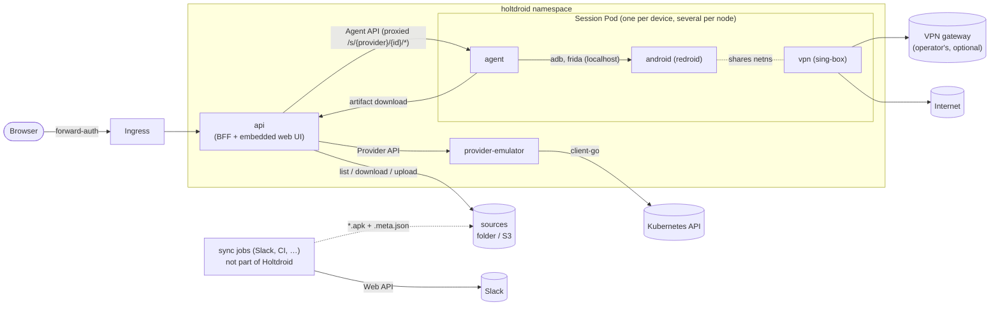
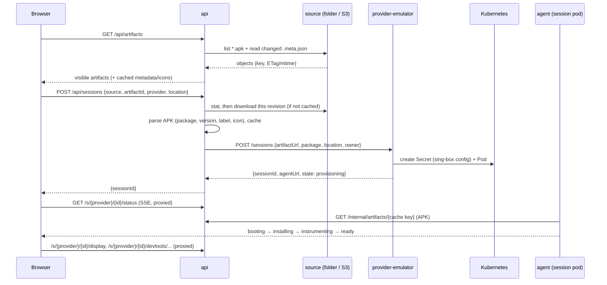
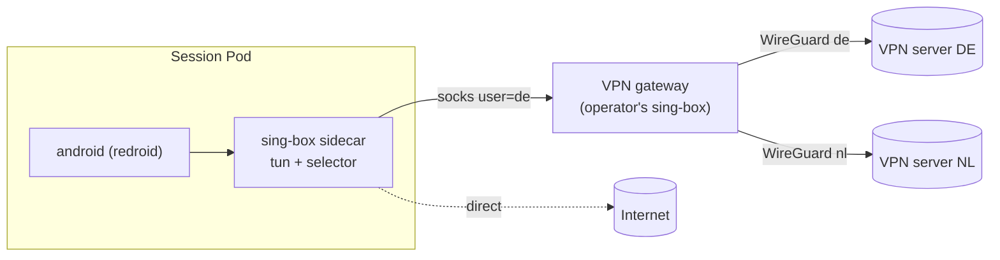
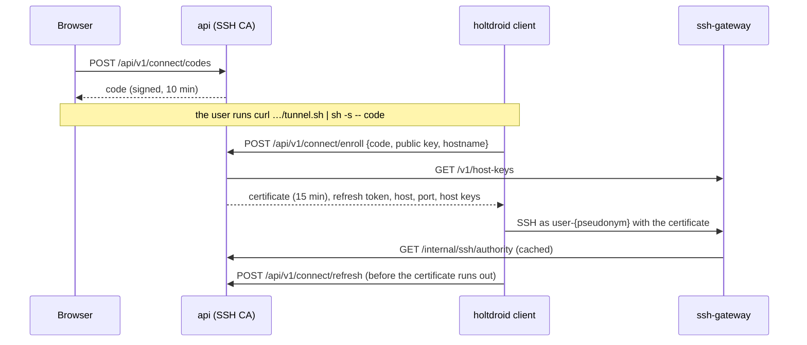

# Architecture

## Goals

1. A user opens one URL, sees the APKs in the configured sources (a folder
   or bucket that a Slack sync or CI fills, plus their own uploads), picks
   one and gets a running Android device with that APK installed.
2. In the same page: the device screen (interactive), Chrome DevTools attached
   to the app's WebViews with a target switcher, two-way clipboard sync, and a
   VPN location selector for the device's traffic.
3. The home page shows all active sessions with owner, uptime, idle countdown
   and location; sessions are bounded (N slots) and are deleted after a period
   of inactivity or a hard TTL.
4. The APK is never modified.
5. Extensible without touching the core: new origins of builds (any job
   that writes files into a source), new device kinds (phones without root exist, rooted phones next), new VPN vendors, new secret backends.

### Non-goals (for now)

- Running APK test suites / CI integration (may come later via the same
  contracts).
- Multi-tenant isolation beyond "who owns which session".
- iOS.
- Play Store images or Google account sign-in.

## Components



All services are the same Go binary (`holtdroid <subcommand>`) and the same
image, except the session image, which adds adb, frida-server and
scrcpy-server to an agent built with Frida, and Android itself, which runs
from the `holtdroid-redroid` image (own repository, decision #82).

| Service | Responsibility | Talks to |
|---------|----------------|----------|
| `api` | UI REST API and static web UI, artifact sources (list, watch, uploads), APK cache, provider registry, session proxy `/s/{provider}/{id}/*` (HTTP + WebSocket), activity tracking, idle/TTL reaper, auth | source stores, providers, agents |
| `provider-emulator` | Owns emulator sessions: slot accounting, creates/deletes session Pods and their per-session Secrets (rendered sing-box config), reports capabilities | Kubernetes API |
| `node-info` | DaemonSet on session nodes: CPU, memory, load and temperature sensors of its node from `/proc` and `/sys`, for the Inventory page (Node API) | nothing; the emulator provider asks it |
| `agent` | Runs inside a session: boots the device, installs and launches the APK under Frida, serves the screen, DevTools proxy, clipboard, network control, status events | ADB, Frida, sing-box clash API |

The **api is stateless**. Providers are the source of truth for sessions; the
emulator provider stores everything in Pod labels/annotations. Identities live
in signed cookies and APKs in a re-fillable cache (`storage`: filesystem or
S3), so api replicas are interchangeable. Sources are folders or S3 prefixes
the api lists itself (see "Artifact sources" below); uploads are files plus a
sidecar in a writable source, so they live wherever that source lives. Activity
timestamps are held in memory by the api and flushed to the provider
(`POST /sessions/{id}/touch`) at most every 30 s, so an api restart loses at
most 30 s of activity.

The api also has a SQL database (decisions.md #22). For now it is in-memory
SQLite only, so it holds nothing that must survive a restart; SQLite with
Litestream replication to S3 and PostgreSQL come later.

## Request flow: launching a session



## Artifact sources

A source is a `storage.Store` — a directory or an S3 bucket/prefix — that the
api lists itself (`internal/source`, decisions.md #27). There is no source
service: anything that wants to publish builds writes files.

```
builds/app.apk
builds/app.apk.meta.json        # optional sidecar
uploads/3f9a1c02b7d4/my.apk     # portal upload
uploads/3f9a1c02b7d4/my.apk.meta.json
```

- **Artifacts.** Every `*.apk` at any depth; hidden entries and unreadable
  directories are skipped. The key is the artifact's identity inside the
  source; the UI API exposes it base64url-encoded.
- **Sidecar.** `<file>.apk.meta.json`, all fields optional, unknown ones
  ignored: `title`, `note`, `changelog`, `uploadedBy`, `uploadedAt`, `link`,
  `origin`, `tags`, `owner`, `visibility` (`public`|`private`). Invalid JSON
  is logged and ignored. Sidecars are memoised by their own revision.
- **Revisions.** ETag on S3, size + mtime on a filesystem, hashed. The APK
  cache key is `hash(source, key, revision)`, the provider gets
  `ArtifactRef = {source}/{key}@{revision}` and an `artifactUrl` pointing at
  that exact cache entry, so a replaced file never mixes with sessions
  started from the old one.
- **Watching.** Each replica lists each source every `pollInterval`
  (default 30 s) and after its own writes, keeps a fingerprint per source,
  queues uncached revisions for warm-up and pushes `event: artifacts` with a
  combined revision over `/api/v1/events`; the UI refetches.
- **Visibility.** `private` artifacts are listed and launchable only for the
  `owner` and admins. Visibility changes and deletes are for the owner and
  admins; ownerless files (dropped by a sync job) only for admins; sources
  marked `readOnly` refuse both.
- **Uploads.** `POST /api/v1/uploads` (multipart, `uploads.maxSize`,
  `uploads.enabled` default true) parses the APK first, writes the sidecar
  then the file to `{uploads.prefix}/{random}/{sanitized name}` in
  `uploads.source` (default: the first source) and seeds the cache.
- **Temporary builds.** Uploads are `temporary` by default. A launch or an
  install records `lastUsedAt` in the sidecar, and the source poll deletes
  temporary builds unused for `uploads.temporaryTTL` (default 7 days). The
  owner and admins can toggle it (decision #42).

## Session lifecycle

```
(queued) → provisioning → booting → installing → (restoring) → instrumenting → ready → (stopping) → gone
                                   ↘ failed (reason) ↗
```

- **Activity** = user input, not traffic (decisions.md #14): the session tab
  tracks pointer/keyboard/wheel/touch input on itself and inside its
  same-origin screen and DevTools iframes, and sends
  `heartbeat {active}` every 30 s while visible. Mutating requests through
  the session proxy (clipboard, location, app actions) and Extend count too.
  An open but untouched tab does not keep a device alive.
- **Reaper** (in api, every 30 s): deletes a session when
  `now - lastActivity > idleTimeout` (default 30m) or
  `now - createdAt > maxTTL` (default 8h). "Extend" in the UI counts as
  activity.
- **App data** (optional, decisions.md #49): stopping or reaping a `ready`
  session first saves the app's data through the agent into the owner's
  saves in `appData.storage`; a launch may name one of them, and the agent
  restores it between installing the APK and starting the app, in the
  `restoring` state.
- **Queue** (decisions.md #57): when every slot of a provider is busy, the
  UI's launch request waits in that provider's line in the api until a slot
  frees up. `queued` is not a session state: no session exists yet, and
  closing the tab cancels the request and gives up the place.
- **Slots**: each provider reports capacity. The emulator provider gives
  every node matching its `nodeSelector` (a label selector) whose taints its
  `tolerations` cover `slotsPerNode` slots (or `nodes.<name>.slots`), named
  `<node>-<n>`, sorted by node name and capped at `slots`; slots of not-Ready
  or cordoned nodes are `offline`. A session takes the first free slot and
  its Pod is pinned to the slot's node with required node affinity and
  labelled with both (decisions.md #29, #82). When no slot is free,
  launching is disabled in the UI.
- **Maintenance** (decisions.md #79): admins hold a slot, or a whole
  provider, from the Inventory page. A held slot reports `maintenance` and
  takes no new sessions; a running session keeps going and the slot reads
  `maintenance` once it ends. Holds are provider state like sessions: the
  emulator provider keeps them in a ConfigMap, the phone provider in its
  state file, the fake one in memory.

## Inventory

`GET /api/v1/admin/inventory` asks every provider's `GET /v1/inventory` in
parallel. Each answer lists the slots as in `capacity`, the session on each
and what the provider can tell about it: phones answer from adb without root
(`agent.Inspect`: getprop, `dumpsys battery`, `dumpsys thermalservice`,
`/proc`, `df /data`) plus the USB host itself (`internal/hostinfo`); the
emulator provider builds a `HostInfo` per node from the Node object and asks
the node-info Pod on that node (Node API) for the CPU model, load, free
memory and sensors, once per slot of that node. Android isn't asked: in
redroid it reads the node's kernel anyway.
Nothing is cached; the page polls every 10 s.

## Emulator session internals

Session Pod (rendered by `provider-emulator`, golden-tested; decision #82):

| Container | Image | Notes |
|-----------|-------|-------|
| `android` | `holtdroid-redroid` | privileged, `runAsUser`/`runAsGroup` 0 (Pod `supplementalGroupsPolicy: Strict`), `emptyDir` on `/data`, ~1 CPU / 1.5–3 GiB. Boot arguments: GPU render node, screen size, density, fps, memfd |
| `agent` | `holtdroid-session` | privileged (reads the Pod's cgroup for metrics). Runs `holtdroid agent` |
| `vpn` | upstream `sing-box` | `NET_ADMIN`, `/dev/net/tun`. Config from the per-session Secret |

All three share the Pod's network namespace. Plus a Secret (sing-box config,
may contain VPN credentials) with an ownerReference to the Pod, so it is
garbage-collected with it. The Pod is named `holtdroid-session-<id>`, has
`restartPolicy: Never`, and carries the session in labels
(`holtdroid/session`, `holtdroid/slot`, `holtdroid/node`) and annotations
(`holtdroid/owner`, `package`, `artifact-ref`, `location`, `created-at`,
`last-activity`; `touch` patches the last one). The provider derives the
session state from the Pod: pending → `provisioning`, the `agent` container
running → `booting`, its readiness probe (`GET /v1/health`, 200 only once
the app runs) passing → `ready`, the `android` or `agent` container or the
Pod terminated → `failed`, deletion requested → `stopping`. While the Pod is
running but not ready, the provider asks the agent for its stage
(`GET /v1/state`), so `installing`, `instrumenting` and failures after boot
are visible too. `agentUrl` is `http://<pod IP>:<agentPort>`; until the Pod
has an IP it is empty and the UI does not open the agent's status stream.

The agent (`internal/agent/redroid`):

1. Connects adb to `127.0.0.1:5555` (redroid's adbd), waits for
   `sys.boot_completed`, runs `adb root` (reconnecting, adbd drops the
   connection when it restarts), adds the VPN routes when a sidecar runs
   (see "VPN"), sets the battery, pushes and starts `frida-server` (same
   pinned version as the agent's devkit, decision #23). The agent reaches it
   directly at `127.0.0.1:27042`. Android's container ending fails the
   session; a later failure (the first install, instrumentation) leaves the
   device running for inspection.
2. Downloads the APK from the api and runs `adb install -r -d -g` (`-d`
   lets later builds downgrade). The generated session wallpaper (`system.js`
   drawing with `Canvas` inside `system_server`) is off on redroid
   (`noWallpaper`): attaching to `system_server` there breaks frida-server.
3. Spawns the package under `agent.js`, which the session image build
   bundles from `frida/agent.ts`:
   - forces `WebView.setWebContentsDebuggingEnabled(true)`: the setter is
     hooked to always pass `true`, and it is called from
     `Instrumentation.callApplicationOnCreate` and after every WebView
     constructor;
   - lets `NetworkSecurityPolicy.isCleartextTrafficPermitted(host)` return
     `true` for `localhost`, `127.0.0.1` and `::1` (decision #45).
   Only the app's main process is instrumented.
4. Polls the process list every second: when the device starts the app by
   itself (the launcher, a broadcast) the agent attaches to its main process
   and loads the same script. Frida's spawn gating is never used on redroid:
   frida-server runs as root on the node's kernel and gating stops every new
   process of the node (decision #82). Rooted phones still use it.
5. Does not restart the app when it exits or crashes (decision #35): the
   device stays `ready` with `appRunning: false` until the user starts it
   from the UI (`POST /app/restart`) or the launcher. `POST /app/reinstall`
   uninstalls first so app data is cleared. `POST /install` replaces the
   build with another one of the same package, over the current one
   (upgrade or downgrade, data kept) or after uninstalling it.

Device controls have no emulator console: the GPS goes through the location
service's test providers and the battery through `dumpsys battery`, as on
rooted phones but without `su`; network speed profiles are not offered. With
VPN locations that carry `geo`/`timezone`, the provider hands them to the
agent (`HOLTDROID_GEO__<ID>__…`), so the GPS and time zone follow the
location as on rooted phones.

The provider configures the agent through environment variables
(`HOLTDROID_ARTIFACTURL`, `HOLTDROID_PACKAGE`, `HOLTDROID_LOCATION`,
`HOLTDROID_SESSION__{ID,OWNER,ARTIFACTREF,SLOT,CREATEDAT}`, and with a VPN
sidecar `HOLTDROID_CLASHAPI`, `HOLTDROID_IPINFOPROXY`,
`HOLTDROID_REDROID__{VPN,BYPASS}` and `HOLTDROID_GEO__…`; see `agent.Config`
for the rest, all with defaults matching the session Pod).

The pipeline only depends on two interfaces, `agent.Device` (adb) and
`agent.Instrumenter` (Frida), so it is unit-tested without a device.

Why ARM-only APKs work: the redroid image carries `libndk_translation` from
Google's Android 15 x86_64 emulator image, so ARM native libraries run
translated inside app processes while ART itself stays x86_64 (Frida's Java
hooks are unaffected). Separate ARM executables don't run: that would need
`binfmt_misc`, which isn't namespaced.

### Screen

scrcpy (decisions #34, #36). Every WebSocket on `/display/scrcpy` makes the
agent push `scrcpy-server` (pinned, in the image at `/opt/scrcpy`) to a fresh
path — the server deletes its jar when it exits — `adb forward` a local port
to `localabstract:scrcpy_<scid>`, start the server over `adb shell` with
`tunnel_forward=true audio=false control=true clipboard_autosync=false` plus
the stream options from the query (`codec` h264/h265/av1, `maxSize`,
`maxFps`, `bitRate`), connect the video socket (retrying until the server's
dummy byte arrives; adb accepts connections before the server listens) and
then the control socket. Device → browser messages carry the video socket's
bytes after the dummy byte: 64-byte device name, codec meta, then packets
with 12-byte frame headers. Browser → device messages are control messages,
written to the control socket as is; device messages on it are dropped.
Closing the WebSocket ends the `adb shell`, which hangs the server up.

Every scrcpy server runs as the shell user (`su 2000` when adbd is root, as
on redroid): the clipboard service refuses root calling as
`com.android.shell` and clears the clipboard instead. Before starting an
H.265 or AV1 stream the agent checks the device's encoders once
(`list_encoders=true`) and closes the WebSocket with code 4001
(`contract.DisplayUnsupportedCodec`) when there is none; the UI then falls
back to H.264. Redroid has software encoders for all three (Codec2 with
gralloc BLOB buffers, set up by the redroid image); a changing 720p screen
costs about a core to encode.

`/display/audio` works the same way with an audio-only server
(`video=false audio=true control=false audio_codec=opus
send_device_meta=false`): the 4-byte codec id (`opus`, or 0/1 when the
device can't capture), then packets. Capture works with `-no-audio`: the
guest still has its audio HAL.

The UI (`web/src/lib/scrcpy.ts`) parses the stream with
`@yume-chan/scrcpy` (`ScrcpyOptions3_3_3`, matching the server version and
options) and decodes it with `@yume-chan/scrcpy-decoder-webcodecs` onto a
`<canvas>` (WebGL, bitmap fallback). Pointer events become touch messages —
the mouse as a generic finger, touch pointers by id, so multi-touch works;
right click is Back, the wheel scrolls. The keyboard has two modes: text
input (printable keys as text, which only covers Latin characters, others as
Android key codes) and a virtual USB keyboard (UHID messages with the HID
descriptor from `@yume-chan/aoa`), where Android applies its own physical
keyboard layout so shortcuts and any alphabet work; a button opens the
device's layout settings. Ctrl/Cmd+V pastes the browser clipboard into the
focused field. Cmd/Win and anything pressed with it stay with the browser
and the OS: the host takes those shortcuts (Cmd+Tab never delivers its
release), and a lone Meta on Android opens system UI. The rail's key
buttons, notifications and quick settings go over the control socket while
the screen is connected and through `/v1/device/actions` otherwise; the
screenshot button saves the last decoded frame. Returning to the tab asks
the server for a key frame (`reset video`). Stream settings and the
keyboard mode are kept in `localStorage`; codecs the browser can't decode are not offered. Device
audio (`web/src/lib/audio.ts`) is decoded with WebCodecs `AudioDecoder` and
played through `@yume-chan/pcm-player`. It is on by default (`audio` in
the stream settings): it connects once the screen is live and the page has
had a click or key press, as browsers require, and reconnects after a drop.
Vibrations come from `/v1/vibrations`: the agent polls `dumpsys
vibrator_manager` every second while someone listens and reports entries
that are new in its current vibration or recent history; the page shows a
toast and, with the audio switch on, plays a synthesized motor buzz of the
vibration's length (`web/src/lib/vibration.ts`). `/v1/screen` reports
whether the display is awake (`dumpsys power` wakefulness) and the
keyguard is up (`dumpsys window` / `dumpsys activity`), polled every second
while someone listens; the page draws a blurred badge over the canvas while
it is off or locked, which fades under the mouse and lets clicks through.
The fake agent tracks the screen-off, lock and unlock actions and wakes on
back-or-screen-on. A rotated device streams a rotated picture. The fake provider
replays a short H.264 recording over the same protocol, refuses other
codecs and reports that it can't capture audio.

### DevTools

- WebView exposes a DevTools endpoint per process on an abstract UNIX socket
  `@webview_devtools_remote_<pid>` (Chrome uses `@chrome_devtools_remote`).
  The agent scans `/proc/net/unix` every 2 s, keeps an
  `adb forward tcp:<port> localabstract:<socket>` per socket and aggregates
  every socket's `/json/list` into `GET /devtools/targets`
  (`{socket, process, id, type, title, url}`). The process name and the
  fallback frontend revision come from the socket's `/json/version`
  (`Android-Package`, `WebKit-Version`). A socket whose `/json/list` fails or times
  out (a WebView busy navigating) keeps its last list while the socket
  exists, so the UI doesn't drop and remount the DevTools frame.
- `WS /devtools/{socket}/page/{id}` reverse-proxies to the forwarded port
  with `Host: localhost` and without `Origin`, because the DevTools HTTP
  handler rejects other Host headers (DNS rebinding protection) and foreign
  origins.
- The DevTools frontend is not bundled in WebView. The agent proxies
  `https://chrome-devtools-frontend.appspot.com/serve_rev/@{rev}/…` under
  `/devtools-frontend/@{rev}/…` with an on-disk cache; `rev` comes from
  the target's `devtoolsFrontendUrl`.
- Everything is same-origin (`/s/{provider}/{id}/…` on the api host). This matters
  because forward-auth cookies (SameSite=Lax) are not sent on WebSockets
  opened from a cross-site iframe.
- The UI's target switcher sets the DevTools iframe `src` to
  `/s/{provider}/{id}/devtools-frontend/@{rev}/inspector.html?wss={host}/s/{provider}/{id}/devtools/{socket}/page/{target}`
  and reconnects automatically when the selected target disappears and a new
  one with the same URL and type appears (the selection is derived from the
  target list on every poll, so a re-created WebView is picked up).

### Clipboard

- The agent keeps one control-only scrcpy server running from boot
  (`video=false audio=false control=true clipboard_autosync=true`,
  reconnecting with backoff). Autosync reports every change of the device
  clipboard as a device message; the agent caches the text, so the clipboard
  works whether or not the app runs and needs no Frida.
- One button in the device rail controls sync: click turns it on or off,
  hovering picks the direction (both ways by default, to the device, from
  the device). Both settings live in `localStorage` with the screen prefs.
- Browser → device: when the tab gains focus or something is copied in the
  page, the UI reads `navigator.clipboard.readText()` (the browser may ask
  for permission once, Safari and Firefox mostly refuse without a click) and
  posts new text to `/clipboard`; the agent sends a set-clipboard message
  and waits for the server's acknowledgement. scrcpy caps a message at
  256 KiB. The portal's own copy buttons (published port links, commands)
  hand their text straight to the sync, without reading the clipboard.
- Device → browser: changes go out over SSE `/clipboard/events`. The UI
  calls `navigator.clipboard.writeText()` when the tab is focused, otherwise
  on the next focus. The last synced text is remembered so a value never
  bounces back.
- Ctrl/Cmd+V on the focused screen pastes through the screen's own control
  socket.

### VPN

- The `vpn` sidecar shares the Pod network namespace with Android and the
  agent. sing-box runs a `tun` inbound (`holtdroid0`) without `auto_route`:
  Android's netd owns the namespace's policy routing and flushes foreign
  rules when it starts (decision #82). The agent adds them as root inside
  Android and re-applies them every 10 s: table 2022 with a default route
  into the tun and `throw` routes for `vpn.bypassCIDRs`, a rule sending every
  uid but 0 there, and a rule for the tun's own /30 so the system stack's
  replies return. Root traffic (the agent, sing-box, Android's root daemons)
  stays direct; the agent checks its egress IP through the sidecar's mixed
  inbound on `127.0.0.1:7890`. sing-box binds its outbounds to `eth0`.
  Loopback is never routed, so `adb reverse` and the SSH tunnels are
  unaffected.
- A location is `{id, label, outbound}` where `outbound` is any sing-box
  outbound or endpoint object, inline or as a secret reference resolving to
  its JSON (decision #28). `internal/vpn` renders them, tagged with the
  location id, plus `direct` (unless `vpn.direct: false`) behind a
  `selector` (`interrupt_exist_connections`). Holtdroid has no VPN vendor
  code.
- DNS: apps' queries (to Android's resolver, plain or DNS-over-TLS) enter
  the tun with the app's uid; the sidecar hijacks plain DNS and answers
  through a resolver that dials `vpn.dns` via the selector. Server names inside outbounds are
  resolved by the Pod's resolver (`local`), or by `vpn.resolver` when set —
  needed for `*.cluster.local` names, which sing-box's `local` sends to mDNS.
- The clash API listens on `127.0.0.1:9090`. `PUT /network/location` on
  the agent maps to `PUT /proxies/select {"name": "<location>"}`.
  Capabilities carry the offered locations and `defaultLocation`
  (`vpn.Config.DefaultLocation`); with `vpn.direct: false` there is no
  `direct` to pick. The UI preselects the last provider launched and the last
  location the user picked per provider (`localStorage`), else the default;
  quick launch uses the same choice without the dialog.
  `GET /network` reports the current selection and the external
  IP/country, looked up through the tunnel at `ipInfoURL` (default
  `https://ipinfo.io/json`, cached 30 s).
- Recommended deployment: the operator runs one shared sing-box **VPN
  gateway** holding one tunnel per location (WireGuard from any vendor, or
  anything sing-box speaks) with a SOCKS inbound whose username selects the
  location (`auth_user` route rules); each location's outbound is that SOCKS
  server with the location as username. One vendor key then serves any
  number of sessions without WireGuard peer collisions. Public docs:
  "Shared VPN gateway".



## Computers: the holtdroid client over SSH

Developers bring a device's ADB to their machine and their machine's dev
servers to the device with the `holtdroid` client (`cmd/holtdroid-connect`,
`internal/connect`), a small Go client that speaks SSH to the
`ssh-gateway`. Decision #64; it replaced browser-held keys and hand-written
`ssh` commands (#21, #38, #46, #61). In a terminal it is a full-screen
bubbletea UI (`internal/connect/tui`) over the client's `Snapshot`; its
golden frames in `testdata/` are also the frames of the animated terminal
on the docs page. It doesn't manage devices (decision #75): Devices opens
a session page (`/session/{provider}/{id}`) or `chrome://inspect` in the
browser, and **Launch a device** opens the portal itself.
With `ssh.insecureTLS` the connect command and the client skip TLS
verification towards the portal (remembered per portal as `insecure` in
the client's state). The gateway's
session list (`/internal/users/{handle}/sessions`, `sessions` messages)
carries each session's package, app name and version for this. The
gateway's first control message, `gateway: {adb, publish}`, tells the
client which of `allowADB` and `allowReverse` are on, so it neither opens
local ADB ports nor requests ports the gateway would refuse, and the UI
explains what is off instead of showing raw SSH errors. Without a terminal it prints status lines
(`connect.Printer`). On start it compares its own SHA-256 with the portal's
`/connect/manifest.json` and, when they differ, updates (asking first unless
`autoUpdate` is set in `holtdroid/client.json`): it downloads into
`~/.cache/holtdroid/holtdroid-{sha256}`, moves the `holtdroid` link there and
`exec`s the new build with the same arguments.

```sh
curl -fsSL https://android.example.com/tunnel.sh | sh -s -- <one-time code>
```

### Enrollment and certificates



- `GET /tunnel.sh` is rendered by the api: the portal URL and the SHA-256
  of every client build in `ssh.clientDir` (the api image carries
  darwin/linux × amd64/arm64 under `/usr/share/holtdroid/connect`). It
  downloads the matching build into `~/.cache/holtdroid`, checks it, links
  `~/.cache/holtdroid/holtdroid` and runs it with `/dev/tty` as
  stdin.
- The client keeps an ed25519 key and its enrollment per portal under the
  user config directory (`holtdroid/connect/{host}/`); it never reads
  `~/.ssh`.
- The api is an SSH user CA (`ssh.caKey`, a PEM secret ref; temporary when
  unset). A certificate's principal is the user's handle, its key id the
  computer id, and its extensions carry the login, admin flag and hostname
  (`control.CertUser`, `CertAdmin`, `CertHostname`). The gateway accepts
  nothing else and keeps no keys; it fetches the CA public key from the api
  and fetches it again (at most every 10 s) when a certificate names another
  one.
- Codes and refresh tokens are HS256 JWTs keyed from the CA key, with
  audiences `connect-code` and `connect-refresh`. A code is spent in the
  memory of the api replica that took it, so with several replicas it could
  be taken once per replica within its 10 minutes. A refresh token is bound
  to the key fingerprint and replaced on every refresh (`gen` + 1); nothing
  is stored, so revocation waits for the persistent database (roadmap 4.11).

### One connection per computer

The client logs in as `user-{pseudonym}`: 16 base32 characters of an HMAC
of the login with `auth.sessionKey`, so the name doesn't reveal the login.
The connection serves all of the user's sessions:

- **Published ports** are ordinary `tcpip-forward` requests. The gateway's
  fanout asks `GET /internal/users/{handle}/sessions` every
  `refreshInterval` (5 s) and opens a `Reverse` tunnel per port and ready
  session, so devices started later get the ports too. `tcpip-forward` is
  answered at once; a device that refuses a port (already published there)
  is retried after 30 s. Traffic counts as activity only for the session it
  went to (`POST /internal/sessions/{slug}/activity`, at most every
  `activityInterval`).
- **ADB** is `direct-tcpip` to `{provider}-{id}:5555`, accepted only for a
  ready session of the user. The client listens on `127.0.0.1:15555` and up,
  one port per session that stays the same while it runs, survives
  reconnects and runs `adb connect`/`disconnect` when `adb` is on `PATH`.
- **The control channel** is the `holtdroid-control@holtdroid` subsystem,
  JSON lines both ways (`internal/contract/control`): the client sends
  `hello` (version, OS, arch) and `state` (loopback listeners with their
  process, published ports, ADB ports) whenever they change; the gateway
  sends `sessions` whenever the user's ready sessions change and `publish`
  when the portal changes the computer's ports. The client keeps the chosen
  ports on disk.

The api's `GET /api/v1/ssh/computers` asks every replica
(`GET /v1/users/{user}/computers`) and `PUT /api/v1/ssh/computers/{id}/published`
goes to the replica that holds the computer, which forwards it as a
`publish` message. The UI's **Computers** page shows each connected computer
with its listening ports as toggles and its ADB ports, plus the connect
command; the header's laptop button counts connected computers.

### The gateway is not a shell server

| SSH request | Behaviour |
|-------------|-----------|
| login | Only certificates from the api's CA whose principal is the requested `user-…` name; a plain key, another CA, an expired certificate or a session slug as the user name fail. |
| `session` channel | Only the control subsystem. `shell` and `exec` print a one-line hint and exit with status 1; other subsystems (sftp) are refused. Nothing is ever executed. |
| `direct-tcpip` | Only `{session}:5555` of the user's own ready sessions with `allowADB`. Every other destination is refused — the gateway must never become a proxy into the cluster. |
| `tcpip-forward` / `cancel-tcpip-forward` | Allowed when `allowReverse` is on and the port is inside `reversePorts` (default `1-65535`). The bind address is ignored; the port is published on the devices' loopback. |
| agent forwarding, X11, `streamlocal` | Refused. |

The version string is OpenSSH's; only an accepted certificate gets the banner
with the logo, login and hostname (decision #47). The gateway sends
`keepalive@openssh.com` every `keepaliveInterval` and closes a connection
whose client misses two, so a dropped laptop releases its ports; the client
does the same in the other direction and reconnects with backoff.

### Tunnels to the device

The gateway never talks to ADB or the device directly; the session's agent
does, through a tunnel endpoint on a **separate agent port**
(`tunnelListen`, default `:8081`) that the api's browser proxy cannot reach:

- **ADB** — per SSH channel the gateway opens `WS /tunnel/adb` on the agent
  and splices bytes. The agent connects it to Android's adbd
  (`adbAddr`, default `127.0.0.1:5555` inside the pod), next to the agent's
  own adb server connection.
- **Published ports** — per port and device the gateway opens
  `WS /tunnel/reverse/{port}`. The agent runs `adb reverse tcp:{port}
  tcp:{local}` so the device's `localhost:{port}` lands on an agent listener,
  and multiplexes each incoming connection as a `hashicorp/yamux` stream over
  that WebSocket; the gateway turns each stream into a `forwarded-tcpip`
  channel to the client. Closing the forward or the connection runs
  `adb reverse --remove`.

Using `adb reverse` instead of a host alias inside the device keeps this
provider-agnostic: physical phones get the same feature for free.

Both endpoints carry the login in `X-Holtdroid-User`; the agent keeps the
open tunnels (`internal/agent.Tunnels`) and streams them to the UI. A tunnel
endpoint that fails before the upgrade answers with a plain HTTP status
(409 for a port already published, 502 when adb fails). When one direction
of a spliced stream ends, it is half-closed where the other end can do that
(TCP, SSH channels, yamux streams) and the rest gets 30 s to finish; the ADB
WebSocket can't half-close, so its end closes both directions (adb never
half-closes). The fake provider serves the same handler with its small adbd
and loopback listeners as device ports (`Provider.DialDevice` is "an app on
the device" in tests).

The session page's **SSH** popover shows the device's tunnels live from the
agent's `GET /v1/tunnels` SSE; while it is open it asks with `?probe=true`,
and each published port is probed through its own tunnel and coloured
(decision #52). It also shows this device's ADB port on each connected
computer, or the connect command when none is connected.

### Configuration

```yaml
# ssh-gateway
listen: ":2222"
httpListen: ":8080"                            # internal API for the api, /v1/health
hostKey: file:/run/secrets/ssh/host_ed25519   # PEM; stable across restarts and replicas; empty = temporary
apiURL: http://holtdroid-api-internal:8081
allowADB: true
allowReverse: true
reversePorts: "1-65535"                        # ports and ranges, comma-separated
maxTunnelsPerConnection: 32
activityInterval: 30s
refreshInterval: 5s
keepaliveInterval: 15s                         # a client that misses two in a row is disconnected
```

```yaml
# api
ssh:
  enabled: true
  gatewayURL: http://holtdroid-ssh-gateway-headless:8080  # every A record is asked
  publicHost: android.example.com                          # where clients connect; default: publicURL's host
  publicPort: 2222
  allowADB: true
  allowReverse: true
  maxTunnelsPerConnection: 32
  caKey: env:SSH_CA_KEY                                    # PEM; empty = temporary
  codeTTL: 10m
  certificateTTL: 15m
  refreshTTL: 720h
  clientDir: /usr/share/holtdroid/connect                  # holtdroid-{os}-{arch} served to tunnel.sh
```

`holtdroid dev` runs the whole gateway in-process (`--ssh :2222`, internal
API on `--ssh-api :8092`, temporary host and CA keys) against the fake
devices' tunnel endpoints (`--tunnels :8091`) and serves client builds from
`bin/connect` (`make connect`).

Exposure is a plain TCP Service (LoadBalancer/NodePort) or an ingress TCP
route (Traefik `IngressRouteTCP` on a dedicated entrypoint). The chart
(`sshGateway.*`) renders the Deployment, a headless Service the api uses to
reach every replica, the SSH Service, the api's `ssh` section, and a
NetworkPolicy rule that lets only the gateway reach the agents' tunnel port.
The emulator provider publishes that port as `tunnelPort` (default 8081)
and reports it as the session's `tunnelUrl`.

## ADB in the browser

The session page also speaks adb itself (decision #51): Tango's
`@yume-chan/adb` runs the protocol in the browser over one WebSocket,
`/s/{provider}/{id}/adb`, which the api proxies to the agent's `WS /adb`
with the signed-in user in `X-Holtdroid-User`. The agent relays packets to
adbd like it does for the SSH gateway's `/tunnel/adb`, refusing the services
that would restart adbd or the device. On a phone the agent is the device
end itself and replays allowed services through the host adb server
(decision #68, "Physical devices" below).

```
browser (Tango) ──WS /s/…/adb──▶ api proxy ──WS /adb──▶ agent ──TCP──▶ adbd
                 adb.browser / adb.ownerOnly      packet filter
```

On that connection the page runs its tools: Logcat (binary `logcat -B`,
filtered to the app's uid, a toast on crashes), Files (sync protocol),
Terminal (shell v2 pty), App (deep links, permissions, force stop, clear
data, doze, standby bucket) and Device (props, WebView provider, demo mode,
bug reports). The connection opens when the device is first ready and lives
as long as the page, so logcat survives app restarts.

## Security model

- Sign-in is `auth.mode`: `anonymous` (random names), `password`, `oidc`,
  `header` (trusted forward-auth proxy) or `none`. The first three use a
  signed JWT cookie (decisions.md #17). `/api/v1/auth*` and the static UI are
  public; everything else under `/api/` and `/s/` requires an identity.
  `allowedGroups` restricts `oidc`/`header`.
- Session pods are **privileged** and Android shares the node's kernel, so
  root in a session (the agent's adbd, the browser's ADB shell) is root on
  the node (decision #82). Run them in a dedicated namespace on nodes
  dedicated to sessions, for users you trust with those nodes.
- Agents are reachable only from the api, their provider (status, installs)
  and the ssh-gateway (NetworkPolicy in the chart); every browser request goes through the api's proxy and auth.
  The agent's tunnel port is never proxied to browsers.
- The ssh-gateway executes nothing and forwards only to the session's ADB and
  to explicitly published device ports; see "SSH access".
- Session owners are recorded; any authenticated user can see sessions, only
  the owner or a member of `adminGroups` can stop them.
- Secrets are referenced, never stored in config files or the repo; see
  [contracts.md](contracts.md#configuration-and-secrets).
- Every action that changes something (sign-in/out, session launch, stop,
  reap, extend, install, location switch, clipboard writes through the agent
  API, artifact upload/update/delete, computer enrollment, SSH connections and
  tunnels) is an audit event: a JSON line with `"log":"audit"` and a schema
  version on stdout of the api or the ssh-gateway, optionally also OTLP logs
  and a batched webhook (`internal/audit`, decision #44). Session actions
  also land in the api's `session_events` table through the same call. The
  api keeps a bounded list of recent events (`audit.store`, optionally a
  JSON lines file) that admins browse on the Audit log page; the
  ssh-gateway forwards its events there (decision #48).

## Observability

Each service can serve Prometheus metrics on a separate port and export
OpenTelemetry traces over OTLP/HTTP (`internal/telemetry`); both are off by
default. Contract clients and servers propagate W3C trace context, so a
launch shows up as one trace through the api, the provider and the agent.
The chart adds a `metrics` port to every pod, a `PodMonitor` for the
components and session pods, and lets the scraper past the sessions
NetworkPolicy. Metric names and the audit schema are listed on the public
"Monitoring and audit" page.

## Physical devices

The first stage exists (decision #67): `provider-physical` runs phones
without root, with the session agents inside its own process, a launcher
instead of Frida, `SlotCapabilities` per phone and a state file. Mitigation
1, the filtering ADB proxy, exists too (decision #68), and so does VPN over
the USB cable: Holtdroid Tunnel on the phone, `adb reverse`, a per-session
sing-box on the host (decision #69). Root mode per phone exists as well
(decision #80): through Magisk `su` the agent runs Frida, the system
language and clock, app data, fake GPS and timezone that follow the VPN
location, a real Wi-Fi network joined through su with all traffic redirected
through the tunnel by iptables TPROXY (no VpnService, no tun, so anti-VPN apps
accept it; it falls back to the VpnService tunnel with a Frida VPN→Wi-Fi
relabel when no `wifi` SSID is set, and a kernel-route tun is behind the
off-by-default `transparentTunnel` flag), root hidden from the app under test
(Magisk DenyList) and a calls lockdown. That `su` escalation is transitional: it
grants `su` to the shell uid, so the layer-3 hardening below (token-auth
frida-server, `su` denied to the shell, a root watchdog) is still the plan,
as is the rest of this section.

A `provider-physical` service manages an inventory of rooted phones (Magisk)
plugged into a host over USB. Slots are phones instead of nodes, one
long-lived agent per phone, `display: scrcpy` through the same bridge in its
agent, VPN through Holtdroid Tunnel over USB (decision #69), and session
end triggers a cleanup instead of a Pod delete. Nothing in api, web or the
contracts needs to change for it; that is the bar every contract change must
keep meeting.

### Threat model

A redroid device is disposable: whatever a user does to Android dies with
the Pod (its root reaches the node, see "Security model" above). A
phone is not, and anyone with `adb shell` runs as the `shell` uid, which can
do a lot without root:

| Threat | How, from ADB or the screen |
|--------|-----------------------------|
| Lock screen PIN/password | `locksettings set-pin`, or Settings on the screen |
| Google account, then FRP after a reset | Settings → Accounts on the screen |
| Factory reset | Settings, or `reboot:recovery` and the recovery menu |
| Bootloader unlock / flashing | `reboot:bootloader`, `fastboot flashing unlock` if OEM unlocking is on |
| Cut off our own access | `settings put global adb_enabled 0`, `svc usb setFunctions …`, Developer options off |
| Persistence across sessions | Device admin or accessibility apps, input methods, extra users or a work profile, a second device owner |
| Broken base system | `pm uninstall --user 0` / `pm disable-user` of system apps, `settings put` in global/secure/system, Wi-Fi/airplane/time |
| Root for the user | `su` from the shell uid, or a client talking to frida-server (root) through a forwarded port |
| Network ADB | `tcpip:5555` exposes adbd on the phone's network |

### Mitigations, in layers

1. **ADB goes through a filtering proxy, never raw.** On a phone the agent's
   `/tunnel/adb` endpoint is not a byte splice to adbd: the agent speaks the
   device side of the adb protocol itself (CNXN without auth, since the SSH
   gateway already authenticated the user), reads every `OPEN` service string
   and replays allowed ones through the host adb server
   (`host:transport:<serial>`). Always refused: `reboot:` in any mode,
   `root:`, `unroot:`, `remount:`, `tcpip:`, `usb:`, `sideload:`,
   `disable-verity:`, `enable-verity:`, `reverse:` (the device would reach
   the provider's host) and forwards to frida-server's ports. Shell commands can't be filtered reliably (`sh -c`,
   `eval`, base64), so `shell:`/`exec:` are a per-provider policy:
   `adb.shell: full | allowlist | off`, with the allowlist covering what IDEs
   need (`adb install` via `abb_exec:package`/`exec:cmd package install`,
   `logcat`, `am`, `pm list`, `getprop`, one command each, no shell
   operators); `sync:` push/pull, `jdwp`, forwards and `framebuffer:` carry
   no commands and pass with every setting. The
   default for phones is `allowlist`; the portal's own features (install,
   screen, DevTools, clipboard, logcat) don't need user shell at all.
2. **A device-owner app (our own minimal DPC)** provisioned once on a fresh
   phone without accounts (`dpm set-device-owner`, never `testOnly`, so the
   shell can't remove it). It sets `DISALLOW_MODIFY_ACCOUNTS`,
   `DISALLOW_FACTORY_RESET`, `DISALLOW_SAFE_BOOT`, `DISALLOW_ADD_USER`,
   `DISALLOW_ADD_MANAGED_PROFILE`, `DISALLOW_OEM_UNLOCK` where supported,
   `setPermittedAccessibilityServices`/`setPermittedInputMethods` to the
   system ones, and an enterprise FRP policy (`setFactoryResetProtectionPolicy`)
   with the operator's account, so even a reset phone unlocks only for them.
   Setting a PIN can't be forbidden, but the DPC registers a reset-password
   token up front and clears a foreign PIN with `resetPasswordWithToken`. It
   must not set `DISALLOW_DEBUGGING_FEATURES` — that kills our ADB too.
3. **Root stays ours.** Root is needed for Frida (decision #1), but not for
   the user: Magisk's superuser policy denies the shell uid, adbd is the
   production (non-root) one, frida-server is started by a Magisk boot script
   with token authentication and is reachable only through the agent. A small
   root watchdog (Magisk service script) re-asserts `adb_enabled=1`, the USB
   functions and Developer options, so the "cut off our own access" row
   becomes a blip instead of a trip to the phone.
4. **Cleanup and verification between sessions.** No snapshots on a phone, so
   the agent and the DPC restore a baseline: uninstall every package not on
   the device's allowlist, `cmd package install-existing` / `pm enable` for
   system apps, clear a PIN through the token, wipe `/sdcard`, reset
   `settings` (global/secure/system) to a recorded snapshot, Wi-Fi, time,
   locale, then check: no accounts, no extra device admins or users, DPC is
   still device owner, OEM unlocking off, root watchdog alive. A phone that
   fails the check is marked `quarantined` (not offered for sessions, visible
   to admins) instead of being handed to the next user. An ephemeral
   secondary user per session (`pm create-user --ephemeral`) is a cleaner
   alternative to evaluate, at the cost of binding scrcpy, DevTools and the
   DPC to that user.
5. **Physical and network.** Phones stay on USB to the host (no wireless ADB
   in production; if used, on an isolated network). The host's USB hub
   should support per-port power switching (`uhubctl`) so a hung phone can
   be power-cycled remotely; the agent can `fastboot reboot` a phone left in
   the bootloader.

Residual risk, documented for operators: a user with `adb.shell: full` can
still make a phone unusable for a while (reboot loops, airplane mode, broken
settings until cleanup); recovery from a damaged base system may need hands
on the phone. Untrusted users should get `allowlist` or `off`.

## Future: Docker-only deployment

Kubernetes is not required by the design, only by the first provider. A
`provider-docker` service would implement the same Provider contract against
the Docker Engine API on one host:

| Concern | Kubernetes (`provider-emulator`) | Docker (`provider-docker`) |
|---------|-----------------------------------|----------------------------|
| Session state | Pod labels/annotations | Container labels (`holtdroid.session=…`) |
| Slots | `slotsPerNode` on matching nodes | Fixed `slots` per host (CPU/RAM budget) |
| VPN | `vpn` container in the Pod | sing-box container, redroid and the agent join it with `network_mode: container:<vpn>` |
| Per-session secret | Secret with ownerReference | Config written to a per-session volume, removed with the session |
| Agent reachability | Pod IP | Container IP on a dedicated bridge network the api is attached to |
| Cleanup | Owner references | Delete everything carrying the session label |

The session image, the agent and everything above the Provider contract stay
the same. To keep the two providers from drifting, the session's container
set (images, env, devices, mounts, the sing-box config) should be described
once in a neutral `internal/session` spec that each provider renders into its
own objects. Several Docker hosts are simply several providers in the api's
`providers` list. Caveat: the provider needs the Docker socket, i.e. root on
that host — document it next to the privileged-pod warning.
