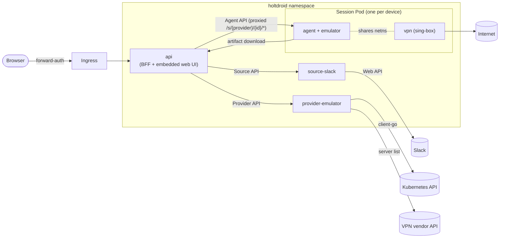
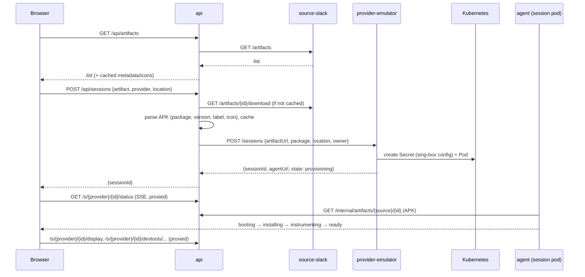

# Architecture

## Goals

1. A user opens one URL, sees the APKs that were shared in a source (a Slack
   channel), picks one and gets a running Android device with that APK
   installed.
2. In the same page: the device screen (interactive), Chrome DevTools attached
   to the app's WebViews with a target switcher, two-way clipboard sync, and a
   VPN location selector for the device's traffic.
3. The home page shows all active sessions with owner, uptime, idle countdown
   and location; sessions are bounded (N slots) and are deleted after a period
   of inactivity or a hard TTL.
4. The APK is never modified.
5. Extensible without touching the core: new artifact sources, new device
   kinds (physical rooted phones next), new VPN vendors, new secret backends.

### Non-goals (for now)

- Running APK test suites / CI integration (may come later via the same
  contracts).
- Multi-tenant isolation beyond "who owns which session".
- iOS.
- Play Store images or Google account sign-in.

## Components



All services are the same Go binary (`holtdroid <subcommand>`) and the same
image, except the session image, which adds the Android emulator, system
image and Frida on top of the agent.

| Service | Responsibility | Talks to |
|---------|----------------|----------|
| `api` | UI REST API and static web UI, registries of sources and providers, APK cache, session proxy `/s/{provider}/{id}/*` (HTTP + WebSocket), activity tracking, idle/TTL reaper, auth | sources, providers, agents |
| `source-slack` | Lists `.apk` files posted in a configured channel, streams downloads | Slack Web API |
| `provider-emulator` | Owns emulator sessions: slot accounting, creates/deletes session Pods and their per-session Secrets, picks VPN servers, reports capabilities | Kubernetes API, VPN vendor API |
| `agent` | Runs inside a session: boots the device, installs and launches the APK under Frida, serves the screen, DevTools proxy, clipboard, network control, status events | ADB, Frida, sing-box clash API |

The **api is stateless**. Providers are the source of truth for sessions; the
emulator provider stores everything in Pod labels/annotations. Identities live
in signed cookies and APKs in a re-fillable cache (`storage`: filesystem or
S3), so api replicas are interchangeable. Activity
timestamps are held in memory by the api and flushed to the provider
(`POST /sessions/{id}/touch`) at most every 30 s, so an api restart loses at
most 30 s of activity.

## Request flow: launching a session



## Session lifecycle

```
provisioning → booting → installing → instrumenting → ready → (stopping) → gone
                                   ↘ failed (reason) ↗
```

- **Activity** = user input, not traffic (decisions.md #14): the session tab
  tracks pointer/keyboard/wheel/touch input on itself and inside its
  same-origin screen and DevTools iframes, and sends
  `heartbeat {active}` every 30 s while visible. Mutating requests through
  the session proxy (clipboard, location, app actions) and Extend count too.
  An open but untouched tab does not keep a device alive.
- **Reaper** (in api, every 30 s): deletes a session when
  `now - lastActivity > idleTimeout` (default 30m) or
  `now - createdAt > maxTTL` (default 8h). "Extend" in the UI counts as
  activity.
- **Slots**: each provider reports capacity. The emulator provider's slot
  count is configured; one session per node is enforced with required pod
  anti-affinity, nodes are selected with nodeSelector/tolerations from Helm
  values. When no slot is free, launching is disabled in the UI.

## Emulator session internals

Session Pod (rendered by `provider-emulator`, golden-tested):

| Container | Image | Notes |
|-----------|-------|-------|
| `emulator` | `holtdroid-session` | privileged, `/dev/kvm` hostPath, `/dev/shm` memory emptyDir, ~3–4 CPU / 5–7 GiB. Runs `holtdroid agent --kind emulator` as PID 1 supervisor |
| `vpn` | upstream `sing-box` | `NET_ADMIN`, `/dev/net/tun`. Config from the per-session Secret |

Plus a Secret (sing-box config, contains the VPN private key) with an
ownerReference to the Pod, so it is garbage-collected with it.

Inside `emulator`, the agent starts and supervises:

1. `Xvfb` → `emulator` (`-gpu swiftshader_indirect -no-snapshot -no-audio
   -no-boot-anim`, x86_64 `google_apis` API 33 image) → `x11vnc` on
   localhost.
2. Waits for `sys.boot_completed`, runs `adb root`, pushes and starts
   `frida-server`.
3. Downloads the APK from the api, `adb install -r`.
4. Spawns the package through frida-go with the instrumentation script:
   - calls `WebView.setWebContentsDebuggingEnabled(true)` on the main thread
     before the first WebView is created;
   - exports clipboard RPC (`getClip`, `setClip`) and registers an
     `OnPrimaryClipChangedListener` that emits messages to the agent.
   The app is in the foreground, so it is allowed to access the clipboard.
5. Re-spawns on app crash/exit; `POST /app/restart|reinstall` drive this
   explicitly.

Why the system image works for ARM-only APKs: Google's x86_64 images from
API 30 ship `libndk_translation`, so ARM native libraries run translated while
ART itself stays x86_64 (Frida's Java hooks are unaffected).

### Screen

The agent serves noVNC static files under `/display/` and bridges its
WebSocket to `x11vnc` (`coder/websocket` ↔ TCP) — no websockify. The
emulator provider advertises `display: novnc`. A future phone provider
advertises `display: scrcpy` and the UI swaps the renderer.

### DevTools

- WebView exposes a DevTools endpoint per process on an abstract UNIX socket
  `@webview_devtools_remote_<pid>` (Chrome uses `@chrome_devtools_remote`).
  The agent scans `/proc/net/unix` every 2 s, keeps an
  `adb forward tcp:<port> localabstract:<socket>` per socket and aggregates
  every socket's `/json` into `GET /devtools/targets`
  (`{socket, process, id, type, title, url}`).
- `WS /devtools/{socket}/page/{id}` reverse-proxies to the forwarded port
  with `Host: localhost`, because the DevTools HTTP handler rejects other Host
  headers (DNS rebinding protection).
- The DevTools frontend is not bundled in WebView. The agent proxies
  `https://chrome-devtools-frontend.appspot.com/serve_rev/@{rev}/…` under
  `/devtools-frontend/@{rev}/…` with an on-disk cache; `rev` comes from
  the target's `devtoolsFrontendUrl`.
- Everything is same-origin (`/s/{provider}/{id}/…` on the api host). This matters
  because forward-auth cookies (SameSite=Lax) are not sent on WebSockets
  opened from a cross-site iframe.
- The UI's target switcher sets the DevTools iframe `src` to
  `/s/{provider}/{id}/devtools-frontend/@{rev}/inspector.html?wss={host}/s/{provider}/{id}/devtools/{socket}/page/{target}`
  and reconnects automatically when the selected target disappears and a new
  one with the same URL and type appears (the selection is derived from the
  target list on every poll, so a re-created WebView is picked up).

### Clipboard

- Browser → device: the user clicks "Paste to device" (needs a user gesture
  for `navigator.clipboard.readText()`), the UI posts to `/clipboard`, the
  agent calls Frida `setClip`.
- Device → browser: listener events go out over SSE
  `/clipboard/events`. The UI calls `navigator.clipboard.writeText()` when the
  tab is focused and always shows the last value in a popover.
- Best-effort fallback: x11vnc/noVNC clipboard is also wired, so text works
  even if the Frida hook is broken.

### VPN

- The `vpn` sidecar shares the Pod network namespace. sing-box runs a `tun`
  inbound with `auto_route` and `route_exclude_address` for the cluster and
  LAN CIDRs (from config). Pod-to-api traffic and replies to proxied requests
  therefore bypass the tunnel, while all emulator egress (TCP, UDP, DNS)
  goes through it with no configuration inside Android.
- The config contains one WireGuard endpoint per offered location plus
  `direct`, behind a `selector` outbound. The clash API listens on
  `127.0.0.1:9090`. `PUT /network/location` on the agent maps to
  `PUT /proxies/select {"name": "<location>"}`. `GET /network` reports the
  current selection and the external IP/country.
- VPN providers live in `internal/vpn` and are used by the emulator provider
  at session creation:
  - `none` — no sidecar;
  - `wireguard` — a static list of `{location, endpoint, publicKey, …}` from
    config;
  - `nordvpn` — queries NordVPN's public server recommendations per country
    and picks, per location, a server not used by any other live session
    (and not in `excludeServers`), because the same WireGuard key on the same
    server from two peers makes their handshakes fight.

## Security model

- Sign-in is `auth.mode`: `anonymous` (random names), `password`, `oidc`,
  `header` (trusted forward-auth proxy) or `none`. The first three use a
  signed JWT cookie (decisions.md #17). `/api/v1/auth*` and the static UI are
  public; everything else under `/api/` and `/s/` requires an identity.
  `allowedGroups` restricts `oidc`/`header`.
- Session pods are **privileged** (KVM, the emulator's networking). Run them in
  a dedicated namespace on nodes you are fine dedicating to this.
- Agents are reachable only from the api (NetworkPolicy in the chart); every
  user-facing request goes through the api's proxy and auth.
- Session owners are recorded; any authenticated user can see sessions, only
  the owner or a member of `adminGroups` can stop them.
- Secrets are referenced, never stored in config files or the repo; see
  [contracts.md](contracts.md#configuration-and-secrets).

## Future: physical devices

A `provider-physical` service manages an inventory of rooted phones (Magisk,
wireless ADB). Slots are phones instead of nodes, one long-lived agent per
phone, `display: scrcpy` via ws-scrcpy, VPN via the WireGuard Android app
controlled by intents, and session end triggers a cleanup (uninstall, clear
data) instead of a Pod delete. Nothing in api, web or the contracts needs to
change for it; that is the bar every contract change must keep meeting.
