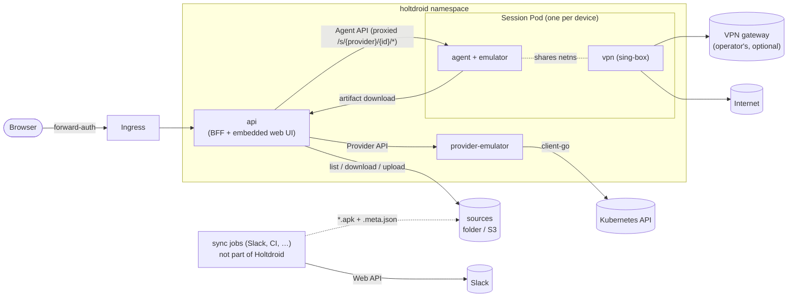
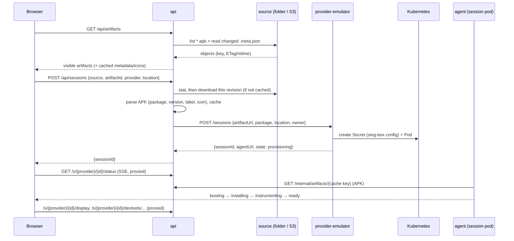
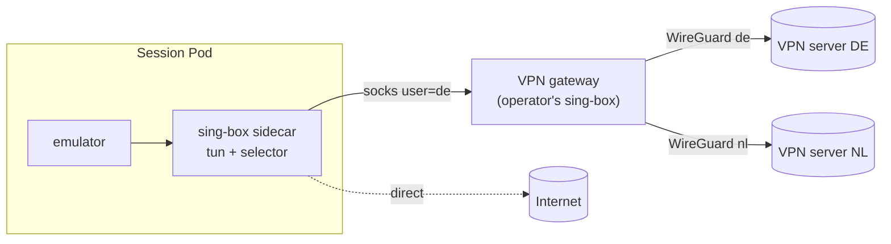

# Architecture

## Goals

1. A user opens one URL, sees the APKs in the configured sources (a folder
   or bucket that a Slack sync or CI fills, plus their own uploads), picks
   one and gets a running Android device with that APK installed.
2. In the same page: the device screen (interactive), Chrome DevTools attached
   to the app's WebViews with a target switcher, two-way clipboard sync, and a
   VPN location selector for the device's traffic.
3. The home page shows all active sessions with owner, uptime, idle countdown
   and location; sessions are bounded (N slots) and are deleted after a period
   of inactivity or a hard TTL.
4. The APK is never modified.
5. Extensible without touching the core: new origins of builds (any job
   that writes files into a source), new device kinds (physical rooted phones next), new VPN vendors, new secret backends.

### Non-goals (for now)

- Running APK test suites / CI integration (may come later via the same
  contracts).
- Multi-tenant isolation beyond "who owns which session".
- iOS.
- Play Store images or Google account sign-in.

## Components



All services are the same Go binary (`holtdroid <subcommand>`) and the same
image, except the session image, which adds the Android emulator, system
image and Frida on top of the agent.

| Service | Responsibility | Talks to |
|---------|----------------|----------|
| `api` | UI REST API and static web UI, artifact sources (list, watch, uploads), APK cache, provider registry, session proxy `/s/{provider}/{id}/*` (HTTP + WebSocket), activity tracking, idle/TTL reaper, auth | source stores, providers, agents |
| `provider-emulator` | Owns emulator sessions: slot accounting, creates/deletes session Pods and their per-session Secrets (rendered sing-box config), reports capabilities | Kubernetes API |
| `agent` | Runs inside a session: boots the device, installs and launches the APK under Frida, serves the screen, DevTools proxy, clipboard, network control, status events | ADB, Frida, sing-box clash API |

The **api is stateless**. Providers are the source of truth for sessions; the
emulator provider stores everything in Pod labels/annotations. Identities live
in signed cookies and APKs in a re-fillable cache (`storage`: filesystem or
S3), so api replicas are interchangeable. Sources are folders or S3 prefixes
the api lists itself (see "Artifact sources" below); uploads are files plus a
sidecar in a writable source, so they live wherever that source lives. Activity
timestamps are held in memory by the api and flushed to the provider
(`POST /sessions/{id}/touch`) at most every 30 s, so an api restart loses at
most 30 s of activity.

The api also has a SQL database (decisions.md #22). For now it is in-memory
SQLite only, so it holds nothing that must survive a restart; SQLite with
Litestream replication to S3 and PostgreSQL come later.

## Request flow: launching a session



## Artifact sources

A source is a `storage.Store` — a directory or an S3 bucket/prefix — that the
api lists itself (`internal/source`, decisions.md #27). There is no source
service: anything that wants to publish builds writes files.

```
builds/app.apk
builds/app.apk.meta.json        # optional sidecar
uploads/3f9a1c02b7d4/my.apk     # portal upload
uploads/3f9a1c02b7d4/my.apk.meta.json
```

- **Artifacts.** Every `*.apk` at any depth; hidden entries and unreadable
  directories are skipped. The key is the artifact's identity inside the
  source; the UI API exposes it base64url-encoded.
- **Sidecar.** `<file>.apk.meta.json`, all fields optional, unknown ones
  ignored: `title`, `note`, `changelog`, `uploadedBy`, `uploadedAt`, `link`,
  `origin`, `tags`, `owner`, `visibility` (`public`|`private`). Invalid JSON
  is logged and ignored. Sidecars are memoised by their own revision.
- **Revisions.** ETag on S3, size + mtime on a filesystem, hashed. The APK
  cache key is `hash(source, key, revision)`, the provider gets
  `ArtifactRef = {source}/{key}@{revision}` and an `artifactUrl` pointing at
  that exact cache entry, so a replaced file never mixes with sessions
  started from the old one.
- **Watching.** Each replica lists each source every `pollInterval`
  (default 30 s) and after its own writes, keeps a fingerprint per source,
  queues uncached revisions for warm-up and pushes `event: artifacts` with a
  combined revision over `/api/v1/events`; the UI refetches.
- **Visibility.** `private` artifacts are listed and launchable only for the
  `owner` and admins. Visibility changes and deletes are for the owner and
  admins; ownerless files (dropped by a sync job) only for admins; sources
  marked `readOnly` refuse both.
- **Uploads.** `POST /api/v1/uploads` (multipart, `uploads.maxSize`,
  `uploads.enabled` default true) parses the APK first, writes the sidecar
  then the file to `{uploads.prefix}/{random}/{sanitized name}` in
  `uploads.source` (default: the first source) and seeds the cache.
- **Temporary builds.** Uploads are `temporary` by default. A launch or an
  install records `lastUsedAt` in the sidecar, and the source poll deletes
  temporary builds unused for `uploads.temporaryTTL` (default 7 days). The
  owner and admins can toggle it (decision #42).

## Session lifecycle

```
provisioning → booting → installing → instrumenting → ready → (stopping) → gone
                                   ↘ failed (reason) ↗
```

- **Activity** = user input, not traffic (decisions.md #14): the session tab
  tracks pointer/keyboard/wheel/touch input on itself and inside its
  same-origin screen and DevTools iframes, and sends
  `heartbeat {active}` every 30 s while visible. Mutating requests through
  the session proxy (clipboard, location, app actions) and Extend count too.
  An open but untouched tab does not keep a device alive.
- **Reaper** (in api, every 30 s): deletes a session when
  `now - lastActivity > idleTimeout` (default 30m) or
  `now - createdAt > maxTTL` (default 8h). "Extend" in the UI counts as
  activity.
- **Slots**: each provider reports capacity. The emulator provider's slots
  are the nodes matching its `nodeSelector` (a label selector) whose taints
  its `tolerations` cover, sorted by name and capped at `slots`; not-Ready or
  cordoned nodes are `offline`. A session takes the first free node and its
  Pod is pinned there with required node affinity, plus required pod
  anti-affinity as a safety net (decisions.md #29). When no slot is free,
  launching is disabled in the UI.

## Emulator session internals

Session Pod (rendered by `provider-emulator`, golden-tested):

| Container | Image | Notes |
|-----------|-------|-------|
| `emulator` | `holtdroid-session` | privileged, `/dev/kvm` hostPath, `/dev/shm` memory emptyDir, ~3–4 CPU / 5–7 GiB. Runs `holtdroid agent` as PID 1 supervisor |
| `vpn` | upstream `sing-box` | `NET_ADMIN`, `/dev/net/tun`. Config from the per-session Secret |

Plus a Secret (sing-box config, may contain VPN credentials) with an
ownerReference to the Pod, so it is garbage-collected with it. The Pod is
named `holtdroid-session-<id>`, has `restartPolicy: Never`, and carries the
session in labels (`holtdroid/session`, `holtdroid/slot`) and annotations
(`holtdroid/owner`, `package`, `artifact-ref`, `location`, `created-at`,
`last-activity`; `touch` patches the last one). The provider derives the
session state from the Pod: pending → `provisioning`, the `emulator`
container running → `booting`, its readiness probe (`GET /v1/health`, 200
only once the app runs) passing → `ready`, the container or Pod terminated →
`failed`, deletion requested → `stopping`. While the Pod is running but not
ready, the provider asks the agent for its stage (`GET /v1/state`), so
`installing`, `instrumenting` and failures after boot are visible too. `agentUrl` is `http://<pod IP>:<agentPort>`; until the Pod
has an IP it is empty and the UI does not open the agent's status stream.

Inside `emulator`, the agent starts and supervises:

1. `emulator`, headless (`-no-window -no-snapshot -no-audio -no-boot-anim`,
   x86_64 `google_apis` API 35 image, the `holtdroid` AVD baked into the
   image; `internal/agent/emulator`). With `HOLTDROID_EMULATOR__GPU=host`
   (the default) and a `/dev/dri/card*` in the container it runs under
   VirtualGL on an Xvfb display with `-gpu host`; otherwise with
   `-gpu swiftshader_indirect` (decision #41).
   Its exit fails the session; a later failure (the first install,
   instrumentation) leaves the device running for inspection.
2. Waits for `sys.boot_completed`, runs `adb root`, pushes and starts
   `frida-server` (same pinned version as the agent's devkit, decision #23).
3. Downloads the APK from the api, `adb install -r -d -g` (`-d` lets later
   builds downgrade), and in the background sets a generated wallpaper on
   the home and lock screens: the Holtdroid logo over a debug grid with the
   session ID, user, start time (UTC), app and build, artifact, node,
   Holtdroid version and the device's Android, ABIs and display.
   `system.js` (`frida/system.ts`) draws it with Android's `Canvas` inside
   `system_server` and calls `WallpaperManager.setBitmap`, so no image or
   font ships with the agent. It is redrawn after `POST /install`; a
   failure is only logged.
4. Spawns the package under `agent.js`, which the session image build
   bundles from `frida/agent.ts`:
   - forces `WebView.setWebContentsDebuggingEnabled(true)`: the setter is
     hooked to always pass `true`, and it is called from
     `Instrumentation.callApplicationOnCreate` and after every WebView
     constructor.
   Only the app's main process is instrumented.
5. Turns on Frida spawn gating: when the device starts the app by itself
   (the launcher, a broadcast) the main process is instrumented the
   same way before it resumes; every other process resumes straight away.
6. Does not restart the app when it exits or crashes (decision #35): the
   device stays `ready` with `appRunning: false` until the user starts it
   from the UI (`POST /app/restart`) or the launcher. `POST /app/reinstall`
   uninstalls first so app data is cleared. `POST /install` replaces the
   build with another one of the same package, over the current one
   (upgrade or downgrade, data kept) or after uninstalling it.

The provider configures the agent through environment variables
(`HOLTDROID_ARTIFACTURL`, `HOLTDROID_PACKAGE`, `HOLTDROID_LOCATION`,
`HOLTDROID_SESSION__{ID,OWNER,ARTIFACTREF,SLOT,CREATEDAT}` for the
wallpaper, `HOLTDROID_EMULATOR__GPU`, `HOLTDROID_CLASHAPI` and `HOLTDROID_EMULATOR__DNSSERVER` when a VPN sidecar
runs; see `agent.Config` for the
rest, all with defaults matching the session image).

The pipeline only depends on two interfaces, `agent.Device` (adb) and
`agent.Instrumenter` (Frida), so it is unit-tested without a device.

Why the system image works for ARM-only APKs: Google's x86_64 images for
API 30 and 34+ (not 31–33, decision #25) ship `libndk_translation`, so ARM native libraries run translated while
ART itself stays x86_64 (Frida's Java hooks are unaffected).

### Screen

scrcpy (decisions #34, #36). Every WebSocket on `/display/scrcpy` makes the
agent push `scrcpy-server` (pinned, in the image at `/opt/scrcpy`) to a fresh
path — the server deletes its jar when it exits — `adb forward` a local port
to `localabstract:scrcpy_<scid>`, start the server over `adb shell` with
`tunnel_forward=true audio=false control=true clipboard_autosync=false` plus
the stream options from the query (`codec` h264/h265/av1, `maxSize`,
`maxFps`, `bitRate`), connect the video socket (retrying until the server's
dummy byte arrives; adb accepts connections before the server listens) and
then the control socket. Device → browser messages carry the video socket's
bytes after the dummy byte: 64-byte device name, codec meta, then packets
with 12-byte frame headers. Browser → device messages are control messages,
written to the control socket as is; device messages on it are dropped.
Closing the WebSocket ends the `adb shell`, which hangs the server up.

Every scrcpy server runs as the shell user (`su 2000` when adbd is root, as
on the emulator): the clipboard service refuses root calling as
`com.android.shell` and clears the clipboard instead. Before starting an
H.265 or AV1 stream the agent checks the device's encoders once
(`list_encoders=true`) and closes the WebSocket with code 4001
(`contract.DisplayUnsupportedCodec`) when there is none; the UI then falls
back to H.264. The emulator has software encoders for all three.

`/display/audio` works the same way with an audio-only server
(`video=false audio=true control=false audio_codec=opus
send_device_meta=false`): the 4-byte codec id (`opus`, or 0/1 when the
device can't capture), then packets. Capture works with `-no-audio`: the
guest still has its audio HAL.

The UI (`web/src/lib/scrcpy.ts`) parses the stream with
`@yume-chan/scrcpy` (`ScrcpyOptions3_3_3`, matching the server version and
options) and decodes it with `@yume-chan/scrcpy-decoder-webcodecs` onto a
`<canvas>` (WebGL, bitmap fallback). Pointer events become touch messages —
the mouse as a generic finger, touch pointers by id, so multi-touch works;
right click is Back, the wheel scrolls. The keyboard has two modes: text
input (printable keys as text, which only covers Latin characters, others as
Android key codes) and a virtual USB keyboard (UHID messages with the HID
descriptor from `@yume-chan/aoa`), where Android applies its own physical
keyboard layout so shortcuts and any alphabet work; a button opens the
device's layout settings. Ctrl/Cmd+V pastes the browser clipboard into the
focused field. The rail's key buttons, notifications and quick settings go
over the control socket while the screen is connected and through
`/v1/device/actions` otherwise; the screenshot button saves the last
decoded frame. Returning to the tab asks the server for a key frame
(`reset video`). Stream settings and the keyboard mode are kept in
`localStorage`; codecs the browser can't decode are not offered. Device
audio (`web/src/lib/audio.ts`) is decoded with WebCodecs `AudioDecoder` and
played through `@yume-chan/pcm-player`; it starts from a click, as browsers
require. A rotated device streams a rotated picture. The fake provider
replays a short H.264 recording over the same protocol, refuses other
codecs and reports that it can't capture audio.

### DevTools

- WebView exposes a DevTools endpoint per process on an abstract UNIX socket
  `@webview_devtools_remote_<pid>` (Chrome uses `@chrome_devtools_remote`).
  The agent scans `/proc/net/unix` every 2 s, keeps an
  `adb forward tcp:<port> localabstract:<socket>` per socket and aggregates
  every socket's `/json/list` into `GET /devtools/targets`
  (`{socket, process, id, type, title, url}`). The process name and the
  fallback frontend revision come from the socket's `/json/version`
  (`Android-Package`, `WebKit-Version`). A socket whose `/json/list` fails or times
  out (a WebView busy navigating) keeps its last list while the socket
  exists, so the UI doesn't drop and remount the DevTools frame.
- `WS /devtools/{socket}/page/{id}` reverse-proxies to the forwarded port
  with `Host: localhost` and without `Origin`, because the DevTools HTTP
  handler rejects other Host headers (DNS rebinding protection) and foreign
  origins.
- The DevTools frontend is not bundled in WebView. The agent proxies
  `https://chrome-devtools-frontend.appspot.com/serve_rev/@{rev}/…` under
  `/devtools-frontend/@{rev}/…` with an on-disk cache; `rev` comes from
  the target's `devtoolsFrontendUrl`.
- Everything is same-origin (`/s/{provider}/{id}/…` on the api host). This matters
  because forward-auth cookies (SameSite=Lax) are not sent on WebSockets
  opened from a cross-site iframe.
- The UI's target switcher sets the DevTools iframe `src` to
  `/s/{provider}/{id}/devtools-frontend/@{rev}/inspector.html?wss={host}/s/{provider}/{id}/devtools/{socket}/page/{target}`
  and reconnects automatically when the selected target disappears and a new
  one with the same URL and type appears (the selection is derived from the
  target list on every poll, so a re-created WebView is picked up).

### Clipboard

- The agent keeps one control-only scrcpy server running from boot
  (`video=false audio=false control=true clipboard_autosync=true`,
  reconnecting with backoff). Autosync reports every change of the device
  clipboard as a device message; the agent caches the text, so the clipboard
  works whether or not the app runs and needs no Frida.
- Browser → device: the user clicks "Paste to device" (needs a user gesture
  for `navigator.clipboard.readText()`), the UI posts to `/clipboard`, the
  agent sends a set-clipboard message and waits for the server's
  acknowledgement. scrcpy caps a message at 256 KiB.
- Device → browser: changes go out over SSE `/clipboard/events`. The UI
  calls `navigator.clipboard.writeText()` when the tab is focused and always
  shows the last value in a popover.
- Ctrl/Cmd+V on the focused screen pastes through the screen's own control
  socket.

### VPN

- The `vpn` sidecar shares the Pod network namespace. sing-box runs a `tun`
  inbound with `auto_route` and `route_exclude_address` for the cluster and
  LAN CIDRs (`vpn.bypassCIDRs`). Pod-to-api traffic and replies to proxied
  requests therefore bypass the tunnel, while all emulator egress (TCP, UDP,
  DNS) goes through it with no configuration inside Android. Loopback is
  never routed, so `adb reverse` and the SSH tunnels are unaffected.
- A location is `{id, label, outbound}` where `outbound` is any sing-box
  outbound or endpoint object, inline or as a secret reference resolving to
  its JSON (decision #28). `internal/vpn` renders them, tagged with the
  location id, plus `direct` (unless `vpn.direct: false`) behind a
  `selector` (`interrupt_exist_connections`). Holtdroid has no VPN vendor
  code.
- DNS: the emulator is started with `-dns-server <vpn.dns>`, so its queries
  enter the tun; the sidecar hijacks them and answers through a resolver
  that dials `vpn.dns` via the selector. Server names inside outbounds are
  resolved by the Pod's resolver (`local`), or by `vpn.resolver` when set —
  needed for `*.cluster.local` names, which sing-box's `local` sends to mDNS.
- The clash API listens on `127.0.0.1:9090`. `PUT /network/location` on
  the agent maps to `PUT /proxies/select {"name": "<location>"}`.
  Capabilities carry the offered locations and `defaultLocation`
  (`vpn.Config.DefaultLocation`); with `vpn.direct: false` there is no
  `direct` to pick. The UI preselects the last provider launched and the last
  location the user picked per provider (`localStorage`), else the default;
  quick launch uses the same choice without the dialog.
  `GET /network` reports the current selection and the external
  IP/country, looked up through the tunnel at `ipInfoURL` (default
  `https://ipinfo.io/json`, cached 30 s).
- Recommended deployment: the operator runs one shared sing-box **VPN
  gateway** holding one tunnel per location (WireGuard from any vendor, or
  anything sing-box speaks) with a SOCKS inbound whose username selects the
  location (`auth_user` route rules); each location's outbound is that SOCKS
  server with the location as username. One vendor key then serves any
  number of sessions without WireGuard peer collisions. Public docs:
  "Shared VPN gateway".



## SSH access

Developers reach a device from their own machine over SSH, without VPNs or
kubectl:

```sh
# ADB from the laptop (Android Studio, scrcpy, adb install, chrome://inspect …)
ssh -N -p 2222 -L 5555:adb:5555 emulator-7f3a9c@android.example.com
adb connect localhost:5555

# make the laptop's dev servers reachable as localhost:3000 / :5000 on the device
ssh -N -p 2222 -R 3000:localhost:3000 -R 5000:localhost:5000 emulator-7f3a9c@android.example.com
```

The SSH username is the session **slug** (`{provider}-{id}`). The api
resolves it by trying the providers whose name plus `-` prefixes the slug,
longest first.

### On the session page

The toolbar's **SSH** popover (`web/src/components/session/ssh-control.tsx`)
shows:

- **Connection status**, live from the agent's `GET /v1/tunnels` SSE: open
  ADB connections with their user, and published ports with their user and
  the number of device-side connections.
- **A port list** kept in `localStorage` (`holtdroid:ssh:ports`, default
  `80`, `443`, `3000-3010`): single ports, ranges up to 256 ports, and
  `device:local` mappings. Each entry is coloured by whether it is
  published right now.
- **One command** with a `-R` per port and optionally `-L 5555:adb:5555`
  (`holtdroid:ssh:adb`). It warns when the count exceeds the gateway's
  `maxTunnelsPerConnection`, which the api mirrors as `ssh.maxTunnels`.

### One gateway, routed by username

There is a single `ssh-gateway` service with one TCP port, not an sshd per
device: one address and host key for everyone, nothing to expose per session,
and the "SSH server of a device" is the gateway acting on behalf of the
session named in the username. It is written on `golang.org/x/crypto/ssh` and
is **not a shell server**:

| SSH request | Behaviour |
|-------------|-----------|
| `session` channel (shell, exec, subsystem/sftp, pty) | Accepted only to print a short help text. `exec` and subsystems (sftp) then exit with status 1; an interactive `shell` stays open, holding the connection's tunnels, until the client sends Ctrl+C or Ctrl+D. Nothing is ever executed. |
| `direct-tcpip` (`-L`) | Allowed when `allowADB` is on and the destination is the alias `adb:5555` (also `localhost:5555`). Every other destination is refused — the gateway must never become a proxy into the cluster. |
| `tcpip-forward` / `cancel-tcpip-forward` (`-R`) | Allowed when `allowReverse` is on and the port is inside `reversePorts` (default `1-65535`; decision #38). Port 0 (dynamic) is refused. The requested bind address is ignored; the port is published on the **device's** loopback. A port another connection already published fails. |
| agent forwarding, X11, `streamlocal`, env, keepalive@openssh | Agent/X11/streamlocal refused, env ignored, keepalives answered. |

### Tunnels to the device

The gateway never talks to ADB or the device directly; the session's agent
does, through a tunnel endpoint on a **separate agent port**
(`tunnelListen`, default `:8081`) that the api's browser proxy cannot reach:

- **ADB (`-L`)** — per SSH channel the gateway opens
  `WS /tunnel/adb` on the agent and splices bytes. The agent connects it to
  the emulator's adbd (`adbAddr`, default `127.0.0.1:5555` inside the pod),
next to the agent's own adb server connection.
- **Published ports (`-R`)** — per forward the gateway opens
  `WS /tunnel/reverse/{port}` and only then answers the `tcpip-forward`
  request, so a port the device can't publish fails on the client. The agent runs `adb reverse tcp:{port}
  tcp:{local}` so the device's `localhost:{port}` lands on an agent listener,
  and multiplexes each incoming connection as a `hashicorp/yamux` stream over
  that WebSocket; the gateway turns each stream into a `forwarded-tcpip`
  channel to the SSH client. Closing the forward or the SSH connection runs
  `adb reverse --remove`.

Using `adb reverse` instead of the emulator's `10.0.2.2` alias keeps this
provider-agnostic: physical phones get the same feature for free.

Both endpoints carry the SSH user in `X-Holtdroid-User`; the agent keeps the
open tunnels (`internal/agent.Tunnels`) and streams them to the UI. A tunnel
endpoint that fails before the upgrade answers with a plain HTTP status
(409 for a port already published, 502 when adb fails). When one direction
of a spliced stream ends, it is half-closed where the other end can do that
(TCP, SSH channels, yamux streams) and the rest gets 30 s to finish; the ADB
WebSocket can't half-close, so its end closes both directions (adb never
half-closes). The fake
provider serves the same handler with an echo server as adbd and loopback
listeners as device ports (`Provider.DialDevice` is "an app on the device"
in tests).

### Keys: the browser is the source of truth

- Users manage public keys on an **SSH keys** page. The list lives in the
  browser (IndexedDB) — add, rename, remove — and is never stored on the
  server.
  Records are scoped to the signed-in user (an anonymous user who picks a
  new name starts with an empty list) and open tabs refresh each other
  through a `BroadcastChannel`. The UI validates keys as they are pasted
  (type, RSA size, private-key paste guard) and shows SHA256 fingerprints;
  the api repeats the validation authoritatively.
- The UI pushes the full list with `PUT /api/v1/ssh/keys` on app start, on
  every change and every 5 minutes while the app is open. The api validates
  the keys (parsed with `x/crypto/ssh`, RSA ≥ 2048, ed25519/ecdsa) and fans
  the list out to every gateway replica (A records of its headless Service)
  together with the user's identity.
- Gateways keep `{fingerprint → user, groups, admin}` **only in memory**, each
  user's set expiring after `keyTTL` (default 24h) unless refreshed. A gateway
  restart forgets everything; the next time the user opens the site, the keys
  are back. This matches the stateless rule — nothing to back up, nothing to
  migrate.
- The same public key registered by two users is rejected for the second one.

### Who may connect where

On login the gateway resolves the slug through the api's internal endpoint
(`GET /internal/sessions/{slug}` → provider, id, owner, state, tunnel URL)
and checks:

- `clientIsolation: false` (default) — any user with a registered key may use
  any running session;
- `clientIsolation: true` — only the session owner and `auth.adminGroups`.

Unknown slug, session not `ready`, or a forbidden user all fail the same way
("no such session") so slugs can't be probed. The reason reaches the client
as an SSH banner, once per connection (clients try every key they have), and
an unregistered key gets a hint to open the portal.

### Activity and lifetime

Traffic through a tunnel counts as activity: the gateway reports
`POST /internal/sessions/{slug}/activity` at most every 30 s
(`activityInterval`) while bytes flow (this is real use of the device even
when no browser tab is open — decision #14 still holds for idle *viewers*).
In quiet intervals it looks the session up instead. Once the session is gone
or no longer `ready`, or the agent drops a published port, the gateway
closes the SSH connection.

### Configuration

```yaml
# ssh-gateway
listen: ":2222"
httpListen: ":8080"                            # key API for the api, /v1/health
hostKey: file:/run/secrets/ssh/host_ed25519   # PEM; stable across restarts and replicas; empty = temporary
apiURL: http://holtdroid-api-internal:8081
allowADB: true
allowReverse: true
clientIsolation: false
reversePorts: "1-65535"                        # ports and ranges, comma-separated
keyTTL: 24h
maxTunnelsPerConnection: 32
activityInterval: 30s
```

```yaml
# api
ssh:
  enabled: true
  gatewayURL: http://holtdroid-ssh-gateway-headless:8080  # every A record gets the key updates
  publicHost: android.example.com                          # shown in the UI commands; default: publicURL's host
  publicPort: 2222
  allowADB: true            # mirror the gateway flags; the UI only uses them to pick
  allowReverse: true        # which commands to show
  clientIsolation: false
  maxTunnelsPerConnection: 32
```

`PUT /api/v1/ssh/keys` validates the list (≤ 32 keys, no duplicates, no
`authorized_keys` options), resolves `gatewayURL`'s host and pushes the
normalized lines to every address. It succeeds when at least one replica
accepted them; a key another user holds fails the whole update with 422 and
the per-key `errors[].location` (`body.keys[i].publicKey`) the UI uses to
mark that row. `holtdroid dev` runs the whole gateway in-process (`--ssh :2222`, key API
on `--ssh-keys :8092`, temporary host key) against the fake devices' tunnel
endpoints (`--tunnels :8091`).

Exposure is a plain TCP Service (LoadBalancer/NodePort) or an ingress TCP
route (Traefik `IngressRouteTCP` on a dedicated entrypoint). The chart
(`sshGateway.*`) renders the Deployment, a headless Service for key pushes,
the SSH Service, the api's `ssh` section, and a NetworkPolicy rule that lets
only the gateway reach the agents' tunnel port. The emulator provider
publishes that port as `tunnelPort` (default 8081) and reports it as the
session's `tunnelUrl`.

## Security model

- Sign-in is `auth.mode`: `anonymous` (random names), `password`, `oidc`,
  `header` (trusted forward-auth proxy) or `none`. The first three use a
  signed JWT cookie (decisions.md #17). `/api/v1/auth*` and the static UI are
  public; everything else under `/api/` and `/s/` requires an identity.
  `allowedGroups` restricts `oidc`/`header`.
- Session pods are **privileged** (KVM, the emulator's networking). Run them in
  a dedicated namespace on nodes you are fine dedicating to this.
- Agents are reachable only from the api and the ssh-gateway (NetworkPolicy in
  the chart); every browser request goes through the api's proxy and auth.
  The agent's tunnel port is never proxied to browsers.
- The ssh-gateway executes nothing and forwards only to the session's ADB and
  to explicitly published device ports; see "SSH access".
- Session owners are recorded; any authenticated user can see sessions, only
  the owner or a member of `adminGroups` can stop them.
- Secrets are referenced, never stored in config files or the repo; see
  [contracts.md](contracts.md#configuration-and-secrets).
- Every action that changes something (sign-in/out, session launch, stop,
  reap, extend, install, location switch, clipboard writes through the agent
  API, artifact upload/update/delete, SSH key sync, SSH connections and
  tunnels) is an audit event: a JSON line with `"log":"audit"` and a schema
  version on stdout of the api or the ssh-gateway, optionally also OTLP logs
  and a batched webhook (`internal/audit`, decision #44). Session actions
  also land in the api's `session_events` table through the same call.

## Observability

Each service can serve Prometheus metrics on a separate port and export
OpenTelemetry traces over OTLP/HTTP (`internal/telemetry`); both are off by
default. Contract clients and servers propagate W3C trace context, so a
launch shows up as one trace through the api, the provider and the agent.
The chart adds a `metrics` port to every pod, a `PodMonitor` for the
components and session pods, and lets the scraper past the sessions
NetworkPolicy. Metric names and the audit schema are listed on the public
"Monitoring and audit" page.

## Future: physical devices

A `provider-physical` service manages an inventory of rooted phones (Magisk)
plugged into a host over USB. Slots are phones instead of nodes, one
long-lived agent per phone, `display: scrcpy` through the same bridge in its
agent, VPN via the WireGuard Android app controlled by intents, and session
end triggers a cleanup instead of a Pod delete. Nothing in api, web or the
contracts needs to change for it; that is the bar every contract change must
keep meeting.

### Threat model

An emulator is disposable: whatever a user does to it dies with the Pod. A
phone is not, and anyone with `adb shell` runs as the `shell` uid, which can
do a lot without root:

| Threat | How, from ADB or the screen |
|--------|-----------------------------|
| Lock screen PIN/password | `locksettings set-pin`, or Settings on the screen |
| Google account, then FRP after a reset | Settings → Accounts on the screen |
| Factory reset | Settings, or `reboot:recovery` and the recovery menu |
| Bootloader unlock / flashing | `reboot:bootloader`, `fastboot flashing unlock` if OEM unlocking is on |
| Cut off our own access | `settings put global adb_enabled 0`, `svc usb setFunctions …`, Developer options off |
| Persistence across sessions | Device admin or accessibility apps, input methods, extra users or a work profile, a second device owner |
| Broken base system | `pm uninstall --user 0` / `pm disable-user` of system apps, `settings put` in global/secure/system, Wi-Fi/airplane/time |
| Root for the user | `su` from the shell uid, or a client talking to frida-server (root) through a forwarded port |
| Network ADB | `tcpip:5555` exposes adbd on the phone's network |

### Mitigations, in layers

1. **ADB goes through a filtering proxy, never raw.** On a phone the agent's
   `/tunnel/adb` endpoint is not a byte splice to adbd: the agent speaks the
   device side of the adb protocol itself (CNXN without auth, since the SSH
   gateway already authenticated the user), reads every `OPEN` service string
   and replays allowed ones through the host adb server
   (`host:transport:<serial>`). Always refused: `reboot:bootloader`,
   `reboot:recovery`, `reboot:sideload`, `root:`, `unroot:`, `remount:`,
   `tcpip:`, `usb:`, `disable-verity:`, `enable-verity:`, forwards to the
   frida-server socket. Shell commands can't be filtered reliably (`sh -c`,
   `eval`, base64), so `shell:`/`exec:` are a per-provider policy:
   `adb.shell: full | allowlist | off`, with the allowlist covering what IDEs
   need (`adb install` via `abb_exec:package`/`exec:cmd package install`,
   `logcat`, `am`, `pm list`, `getprop`, `sync:` push/pull, `jdwp`). The
   default for phones is `allowlist`; the portal's own features (install,
   screen, DevTools, clipboard, logcat) don't need user shell at all.
2. **A device-owner app (our own minimal DPC)** provisioned once on a fresh
   phone without accounts (`dpm set-device-owner`, never `testOnly`, so the
   shell can't remove it). It sets `DISALLOW_MODIFY_ACCOUNTS`,
   `DISALLOW_FACTORY_RESET`, `DISALLOW_SAFE_BOOT`, `DISALLOW_ADD_USER`,
   `DISALLOW_ADD_MANAGED_PROFILE`, `DISALLOW_OEM_UNLOCK` where supported,
   `setPermittedAccessibilityServices`/`setPermittedInputMethods` to the
   system ones, and an enterprise FRP policy (`setFactoryResetProtectionPolicy`)
   with the operator's account, so even a reset phone unlocks only for them.
   Setting a PIN can't be forbidden, but the DPC registers a reset-password
   token up front and clears a foreign PIN with `resetPasswordWithToken`. It
   must not set `DISALLOW_DEBUGGING_FEATURES` — that kills our ADB too.
3. **Root stays ours.** Root is needed for Frida (decision #1), but not for
   the user: Magisk's superuser policy denies the shell uid, adbd is the
   production (non-root) one, frida-server is started by a Magisk boot script
   with token authentication and is reachable only through the agent. A small
   root watchdog (Magisk service script) re-asserts `adb_enabled=1`, the USB
   functions and Developer options, so the "cut off our own access" row
   becomes a blip instead of a trip to the phone.
4. **Cleanup and verification between sessions.** No snapshots on a phone, so
   the agent and the DPC restore a baseline: uninstall every package not on
   the device's allowlist, `cmd package install-existing` / `pm enable` for
   system apps, clear a PIN through the token, wipe `/sdcard`, reset
   `settings` (global/secure/system) to a recorded snapshot, Wi-Fi, time,
   locale, then check: no accounts, no extra device admins or users, DPC is
   still device owner, OEM unlocking off, root watchdog alive. A phone that
   fails the check is marked `quarantined` (not offered for sessions, visible
   to admins) instead of being handed to the next user. An ephemeral
   secondary user per session (`pm create-user --ephemeral`) is a cleaner
   alternative to evaluate, at the cost of binding scrcpy, DevTools and the
   DPC to that user.
5. **Physical and network.** Phones stay on USB to the host (no wireless ADB
   in production; if used, on an isolated network). The host's USB hub
   should support per-port power switching (`uhubctl`) so a hung phone can
   be power-cycled remotely; the agent can `fastboot reboot` a phone left in
   the bootloader.

Residual risk, documented for operators: a user with `adb.shell: full` can
still make a phone unusable for a while (reboot loops, airplane mode, broken
settings until cleanup); recovery from a damaged base system may need hands
on the phone. Untrusted users should get `allowlist` or `off`.

## Future: Docker-only deployment

Kubernetes is not required by the design, only by the first provider. A
`provider-docker` service would implement the same Provider contract against
the Docker Engine API on one host:

| Concern | Kubernetes (`provider-emulator`) | Docker (`provider-docker`) |
|---------|-----------------------------------|----------------------------|
| Session state | Pod labels/annotations | Container labels (`holtdroid.session=…`) |
| Slots | Nodes with KVM, anti-affinity | Fixed `slots` per host (CPU/RAM budget) |
| VPN | `vpn` container in the Pod | sing-box container, emulator joins it with `network_mode: container:<vpn>` |
| Per-session secret | Secret with ownerReference | Config written to a per-session volume, removed with the session |
| Agent reachability | Pod IP | Container IP on a dedicated bridge network the api is attached to |
| Cleanup | Owner references | Delete everything carrying the session label |

The session image, the agent and everything above the Provider contract stay
the same. To keep the two providers from drifting, the session's container
set (images, env, devices, mounts, the sing-box config) should be described
once in a neutral `internal/session` spec that each provider renders into its
own objects. Several Docker hosts are simply several providers in the api's
`providers` list. Caveat: the provider needs the Docker socket, i.e. root on
that host — document it next to the privileged-pod warning.
