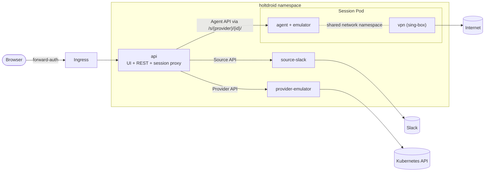
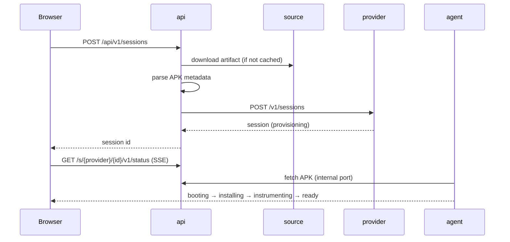

Holtdroid is a handful of small services built from **one Go binary**
(`holtdroid <subcommand>`), plus a heavier session image that contains the
Android emulator.

| Service               | Role                                                                                                                                                                                                         |
| --------------------- | ------------------------------------------------------------------------------------------------------------------------------------------------------------------------------------------------------------ |
| **api**               | Serves the web UI and its REST API, merges artifacts from all sources, caches and parses APKs, asks providers for sessions, proxies all session traffic, tracks activity and reaps idle sessions. Stateless. |
| **source-slack**      | An _artifact source_: lists `.apk` files posted in Slack channels and streams them.                                                                                                                          |
| **provider-emulator** | A _device provider_: owns emulator sessions as Kubernetes Pods, accounts for slots, picks VPN servers.                                                                                                       |
| **agent**             | Runs inside each session: boots the device, installs and instruments the app, serves the screen, DevTools, clipboard and network controls.                                                                   |

## Design principles

- **Contracts between services.** Sources, providers and agents are HTTP
  APIs with a shared conformance suite. The api knows nothing about Slack,
  Kubernetes or ADB. See [Contracts](/holtdroid/extending/contracts/).
- **Stateless api, no database.** Nothing the api needs lives only in its
  memory or on its disk:
  - sessions belong to providers — the emulator provider keeps them as labels
    and annotations on the session Pods it creates, so listing Pods _is_
    listing sessions;
  - sign-ins are signed cookies, verifiable by any replica holding the same
    `auth.sessionKey`;
  - user activity is flushed to the provider every 30 seconds;
  - downloaded APKs are a cache (filesystem or S3) that refills from the
    sources.

  Kill the api, reschedule it to another node or run three replicas — nobody
  notices.

- **Same origin for everything.** Browser traffic to a device goes through
  `https://<portal>/s/<session>/…`. That keeps forward-auth cookies working
  for WebSockets inside iframes and means users need nothing installed
  locally.
- **No lock-in.** Auth, secrets and VPN are interfaces with vendor-neutral
  defaults.

## Launching a session

