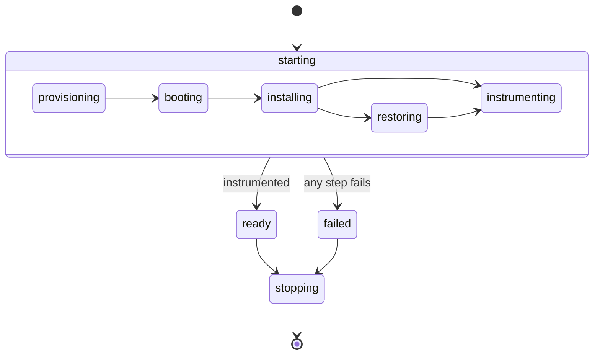

A **session** is one device running one APK for one user. A **slot** is a
place a session can run: for the emulator provider, one of a node's
`slotsPerNode` places; for the
[phone provider](/configuration/phones/), a phone.

## States

`failed` sessions keep their slot until they are stopped or reaped, so the
reason stays visible on the home page.

## The session page

The browser tab of a session page is titled with the app's name, so several
open sessions are easy to tell apart. The page has a header and three
columns.

The **header** has the app's icon, name, version and state, and badges for
the device (model or screen and its size in pixels), the Android version,
the WebView and the VPN location, then the slot's label. On the right:

- **Stops when idle in** (or **Stops in**, when the session's lifetime ends
  first) with the time left and a bar of five segments that empty as the
  deadline nears; it turns amber in the last five minutes;
- with [recordings](/concepts/recordings/) on: **Record**, or while
  recording the elapsed time, which adds a marker when clicked; **Share**
  copies the recording's link, and the **…** menu adds a marker, opens the
  recording, stops sharing or stops recording;
- **Extend** and **Stop**.

The **Device** panel on the left holds the device's controls as rows in
three tabs: **Environment** (Network, Location, Battery, Language, Time,
Clipboard, Display), **Media** (Stream, Microphone, Camera, Recording) and
**App** (App, Device, SSH). Each row shows a summary; the chevron opens it
in place with all of its controls, and a row with something changed from
the default is marked **Changed**. The search button filters the rows of
all three tabs by name. Rows a session can't use (a camera on a device
without one) aren't shown.

In the middle is the **stage**: the device's screen in its frame, with a
toolbar beside it (under it while the screen is in landscape): Back, Home,
Recent apps, Notifications, Quick settings; Rotate (hover it for left and
right), Screenshot, the keyboard mode (text input or a USB keyboard),
Volume (hover for the slider and mute), Power (click for the key, hover for
wake, lock and screen off and what the key does); and **Restart app**. The
stage and the tools card on the right share the space; drag the handle
between them, or let the stage fit the screen.

On the right are the [session tools](/session-tools/overview/).

## The app inside a session

When the app is closed or crashes it stays closed: the device stays `ready`
and a card over the screen says so, with **Reopen**. After a crash the card
names the exception and has **Logcat**, which opens the stack trace, and
can be dismissed. Restart, reinstall and **Save app data now** are in the
App row too. Starting it from the device's app drawer works as well;
DevTools and clipboard sync attach either way.

On emulator sessions the home screen holds only the app under test, on a
wallpaper with the Holtdroid logo; the system apps are in the app drawer
and there is no search bar. Text pasted from the browser lands in the
device's clipboard without Android's clipboard preview popping up.

**Switch version** (click the app's name and icon in the session header)
lists every build with the same application ID that the device runs (of
the x86 and ARM builds of one version, the device's own) and installs the
chosen one into the running device:

- with **Keep app data** on (default) it is installed over the current
  build, upgrade or downgrade, so you can test how the app's storage
  migrates. Builds signed with another key can't be installed this way;
- with it off, the current build and its data are removed first.

If the install fails, the previous build keeps running.

## The screen

States of the device show as a small card over the last frame instead of
hiding it:

- **Screen is off**, since when and for how long, with **Wake**;
  right-clicking the screen wakes it too;
- **Locked**, with **Unlock**; swiping up on the screen works as well;
- **Reconnecting to the device**, with how old the last frame is: the frame
  turns grey and input pauses until the stream is back;
- **… crashed** or **… is closed** at the top (see above).

## Metrics

The App and Device rows show the load every two seconds. The App row
has the app's own CPU and memory, per process too (WebView renderers
included), and the frames it renders with how many of them are janky. The
Device row has the device's CPU and memory, free space on `/data`,
temperatures and, for emulators, the CPU, memory and throttling of the
session Pod (Android, the agent and the VPN sidecar together). Android in redroid runs on the node's kernel, whose `/proc` shows
the whole node, so an emulator's device CPU and memory are the Pod's: its
cores are the Pod's CPU limit, its memory the Pod's memory limit, and the
app's CPU is a percent of that limit. Its sensor readings and the total of
`/data` are the node's. The screen stream's own numbers (frames shown,
bitrate and dropped frames, as decoded in this browser) are in the Stream
row, and the device's network traffic with the external IP in the Network
row.

The device is only measured while a session page is open and visible.

## Activity and reaping

A session counts as active when someone actually uses it:

- keyboard, mouse, wheel or touch input anywhere on its session page,
  including the device screen and the DevTools panel, while the tab is
  visible (reported every 30 seconds);
- a clipboard action, location switch, app restart, device button or
  device setting change;
- the user presses **Extend**.

An open tab that nobody touches does **not** keep the device alive.

The api deletes a session when it has been idle longer than
`sessions.idleTimeout` (default `30m`), or when it is older than
`sessions.maxTTL` (default `8h`) regardless of activity. The home page shows
both deadlines as countdowns.

## Slots

Each provider reports its slots as `free`, `busy`, `offline` or
`maintenance`. The emulator
provider runs `slotsPerNode` sessions per node (or a per-node count) and at
most `slots` sessions overall. Nodes are chosen with the chart's
`nodeSelector` and `tolerations`. When nothing is free, a launch waits in
line on the launch page and starts as soon as a slot frees up, first come
first served; leaving the page gives up the place. The line lives in the api
replica's memory, so a restart drops it.

Admins see every slot on the **Inventory** page (the server icon in the
dock): the device's or node's model, system, battery, memory, storage and
temperature sensors, and the session running on it. **Hold** keeps new
sessions off a slot, or off a whole provider, while someone works on it; a
running session keeps going, and the slot shows `maintenance` once it ends
until an admin releases it. Holds are kept by the provider, so restarts
don't lose them.

## Ownership

The user who launched a session is its owner. Every signed-in user can see
all sessions; only the owner and members of `auth.adminGroups` can stop or
extend them or use their ADB tools (`adb.ownerOnly`). Your
[connected computer](/concepts/ssh/) reaches only your own
sessions.
