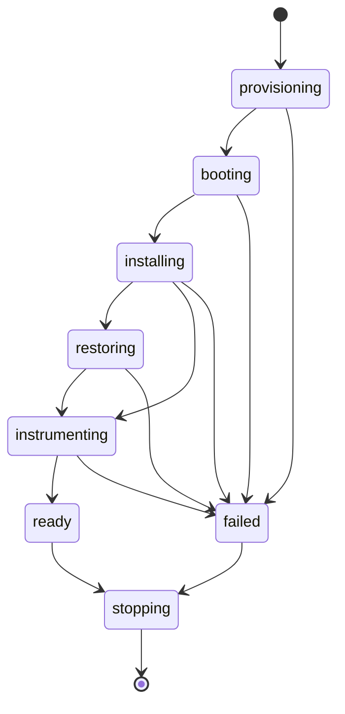

A **session** is one device running one APK for one user. A **slot** is a
place a session can run: for the emulator provider, one of a node's
`slotsPerNode` places; for the
[phone provider](/holtdroid/configuration/phones/), a phone.

## States

`failed` sessions keep their slot until they are stopped or reaped, so the
reason stays visible on the home page.

## The app inside a session

When the app is closed or crashes it stays closed: the device stays `ready`
and the play button next to the app's name in the session header starts it
again; restart, reinstall and **Save app data now** sit next to it. Starting
it from the device's app drawer works as well; DevTools and clipboard sync
attach either way.

**Switch version** (click the app's name and icon in the session header)
lists every build with the same application ID and installs the chosen one into the
running device:

- with **Keep app data** on (default) it is installed over the current
  build, upgrade or downgrade, so you can test how the app's storage
  migrates. Builds signed with another key can't be installed this way;
- with it off, the current build and its data are removed first.

If the install fails, the previous build keeps running.

## The screen

While the device's display is off or its lock screen is showing, a
translucent badge in the middle of the screen says so. Right-click the
screen to wake it, or use **Wake and unlock** under the power key on the
side of the phone. The badge
fades away under the mouse and lets clicks through to the device.

## Metrics

A bar at the bottom of the session page shows the load every two seconds:
device CPU and memory, the app's own CPU and memory per process (WebView
renderers included), the frames it renders and how many of them are janky,
free space on `/data`, temperatures and, for emulators, the CPU, memory and throttling of the session
Pod (Android, the agent and the VPN sidecar together). Hover an item for
details. Android in redroid runs on the node's kernel, so its sensor
readings are the node's. The screen stream's own numbers (frames shown,
bitrate and dropped frames, as decoded in this browser) are in the stream
card next to the phone, and the device's network traffic with the external
IP in the network card.

The device is only measured while a session page is open and visible.

## Activity and reaping

A session counts as active when someone actually uses it:

- keyboard, mouse, wheel or touch input anywhere on its session page,
  including the device screen and the DevTools panel, while the tab is
  visible (reported every 30 seconds);
- a clipboard action, location switch, app restart, device button or
  device setting change;
- the user presses **Extend**.

An open tab that nobody touches does **not** keep the device alive.

The api deletes a session when it has been idle longer than
`sessions.idleTimeout` (default `30m`), or when it is older than
`sessions.maxTTL` (default `8h`) regardless of activity. The home page shows
both deadlines as countdowns.

## Slots

Each provider reports its slots as `free`, `busy`, `offline` or
`maintenance`. The emulator
provider runs `slotsPerNode` sessions per node (or a per-node count) and at
most `slots` sessions overall. Nodes are chosen with the chart's
`nodeSelector` and `tolerations`. When nothing is free, a launch waits in
line on the launch page and starts as soon as a slot frees up, first come
first served; leaving the page gives up the place. The line lives in the api
replica's memory, so a restart drops it.

Admins see every slot on the **Inventory** page (the server icon in the
header): the device's or node's model, system, battery, memory, storage and
temperature sensors, and the session running on it. **Hold** keeps new
sessions off a slot, or off a whole provider, while someone works on it; a
running session keeps going, and the slot shows `maintenance` once it ends
until an admin releases it. Holds are kept by the provider, so restarts
don't lose them.

## Ownership

The user who launched a session is its owner. Every signed-in user can see
all sessions; only the owner and members of `auth.adminGroups` can stop or
extend them or use their ADB tools (`adb.ownerOnly`). Your
[connected computer](/holtdroid/concepts/ssh/) reaches only your own
sessions.
