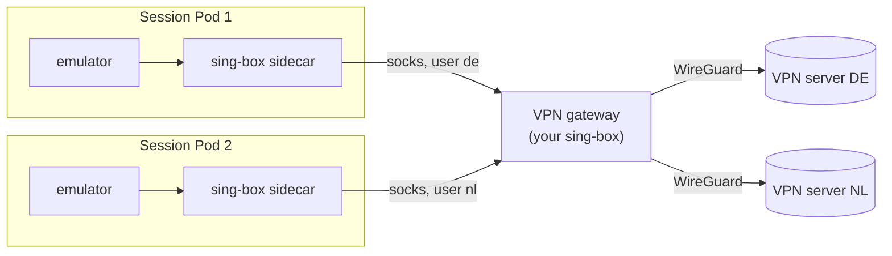

Every emulator session can route all of the device's traffic (TCP, UDP and
DNS) through a VPN, and the user can switch the location from the session
toolbar at any time.

## How it works

The session Pod has a `vpn` sidecar running [sing-box](https://sing-box.sagernet.org/)
in the Pod's network namespace:

- a `tun` inbound with `auto_route` captures all egress from the emulator;
- cluster and LAN ranges (`vpn.bypassCIDRs`) are excluded, so the portal can
  still reach the agent;
- each location is a sing-box outbound, plus `direct`, behind a selector;
- switching location changes the selector through sing-box's local API, so
  the switch is instant and needs no restart;
- the device's DNS queries are captured from the tunnel and resolved through
  the selected location, so lookups don't leak;
- those lookups return IPv4 addresses only (`AAAA` answers are empty), so
  the device never tries IPv6 through a location that can't carry it.

The launch dialog shows a location's flag when its `id` or `label` is a
country code or name. It and the quick-launch button use the location you
used last time with that provider, or with **Any** (remembered in the browser's `localStorage`, also when you switch
during a session). If there is none, or it is no longer offered, it falls
back to the configured default (`vpn.default`). With `vpn.direct: false`
there is no VPN-less option at all.

Android itself is not configured at all; to apps it looks like a normal
network. Port forwarding (`adb reverse`, [your connected computer](/holtdroid/concepts/ssh/))
runs over loopback and is unaffected by the VPN.

## Locations are sing-box outbounds

Holtdroid has no code for any particular VPN vendor. A location is an id, a
label and a [sing-box outbound](https://sing-box.sagernet.org/configuration/outbound/)
(or endpoint, such as WireGuard): SOCKS, Shadowsocks, VLESS, Hysteria,
WireGuard, anything sing-box speaks. Holtdroid only tags it with the location
id and puts it behind the selector.

Every session Pod runs its own copy of these outbounds. That is fine for
proxies that accept many connections with the same credentials, but not for
WireGuard: VPN services usually give one key per account, and the same key
connected from several Pods at once makes the peers knock each other off.

## Recommended: a shared VPN gateway

Run one sing-box yourself as a **VPN gateway**. It holds the real VPN
connection, one tunnel per location, and offers a SOCKS server where the
username selects the location. Each Holtdroid location is then just "SOCKS to
the gateway, user `de`":

- One key per location serves any number of sessions.
- Switching stays per session: each sidecar has its own selector.
- Sessions on the same location share its egress IP.
- Adding a vendor or a country is a change to the gateway, not to Holtdroid.

[Shared VPN gateway](/holtdroid/operations/vpn-gateway/) has a complete
setup. Configuration keys are on the [emulator provider](/holtdroid/configuration/emulator/#vpn)
page.
