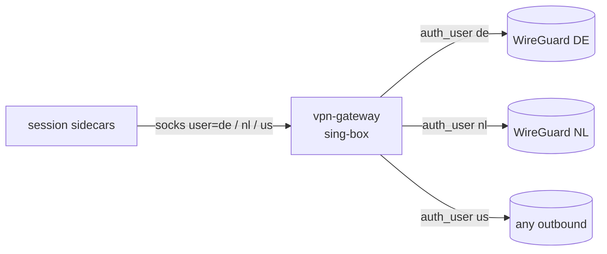

Holtdroid gives every session its own sing-box sidecar, and each location is
a plain sing-box outbound (see [Per-session VPN](/concepts/vpn/)).
Putting WireGuard straight into those outbounds breaks as soon as two
sessions use the same location: VPN services hand out one key per account,
and one key connected from several places at once makes the peers fight.

The fix is a gateway you run once: a single sing-box that keeps one tunnel
per location and offers a SOCKS server where the **username picks the
location**. Holtdroid's sidecars only talk SOCKS to it. The gateway is not
part of Holtdroid; it is an ordinary sing-box deployment, so any vendor or
protocol sing-box supports works.



## Gateway config

One SOCKS inbound, one user per location, one tunnel per location, and a
route rule per user. Anything that matches no user is rejected.

```json
{
  "log": { "level": "warn", "timestamp": true },
  "dns": { "servers": [{ "type": "local", "tag": "local" }] },
  "inbounds": [
    {
      "type": "socks",
      "tag": "socks",
      "listen": "::",
      "listen_port": 1080,
      "users": [
        { "username": "de", "password": "holtdroid" },
        { "username": "nl", "password": "holtdroid" }
      ]
    }
  ],
  "endpoints": [
    {
      "type": "wireguard",
      "tag": "de",
      "mtu": 1280,
      "address": ["10.5.0.2/32"],
      "private_key": "<your WireGuard private key>",
      "peers": [
        {
          "address": "de1234.nordvpn.com",
          "port": 51820,
          "public_key": "<server public key>",
          "allowed_ips": ["0.0.0.0/0", "::/0"]
        }
      ]
    },
    {
      "type": "wireguard",
      "tag": "nl",
      "mtu": 1280,
      "address": ["10.5.0.2/32"],
      "private_key": "<your WireGuard private key>",
      "peers": [
        {
          "address": "nl987.nordvpn.com",
          "port": 51820,
          "public_key": "<server public key>",
          "allowed_ips": ["0.0.0.0/0", "::/0"]
        }
      ]
    }
  ],
  "route": {
    "rules": [
      { "auth_user": ["de"], "outbound": "de" },
      { "auth_user": ["nl"], "outbound": "nl" },
      { "inbound": ["socks"], "action": "reject" }
    ],
    "default_domain_resolver": "local"
  }
}
```

- `mtu: 1280` keeps WireGuard packets under the MTU of overlay networks
  (flannel VXLAN is 1450); the default 1420 fails with
  `sendmmsg: message too long`.
- sing-box runs WireGuard in userspace, so the gateway needs no
  `NET_ADMIN` or TUN device.
- The SOCKS password only has to match Holtdroid's config. The hop is
  unencrypted, so keep it inside the cluster and let only session Pods in
  (the NetworkPolicy below). If it has to cross an untrusted network, use an
  encrypted inbound (Shadowsocks, VLESS + TLS) with the same `auth_user`
  rules instead.
- Using the same key elsewhere (another gateway, a laptop)? Give each place
  different servers.

### NordVPN

NordVPN's WireGuard ("NordLynx") uses one private key per account and the
interface address `10.5.0.2/32`. With an access token from the Nord Account
dashboard:

```sh
# the private key
curl -s -u "token:$NORD_TOKEN" https://api.nordvpn.com/v1/users/services/credentials \
  | jq -r .nordlynx_private_key

# a recommended server and its public key, per country (81 = Germany)
curl -s 'https://api.nordvpn.com/v1/servers/recommendations?filters[country_id]=81&filters[servers_technologies][identifier]=wireguard_udp&limit=1' \
  | jq '.[0] | {hostname, key: (.technologies[] | select(.identifier == "wireguard_udp") | .metadata[] | select(.name == "public_key") | .value)}'
```

Other WireGuard services (Mullvad, Proton, your own server) give you the
same three things: a private key, an interface address, and per server a
host and public key.

## On Kubernetes

Store the config in a Secret (it holds the private key; an
`ExternalSecret` or sealed secret works the same) and run it as a small
Deployment with a Service:

```yaml
apiVersion: apps/v1
kind: Deployment
metadata: { name: vpn-gateway, namespace: vpn }
spec:
  replicas: 1
  selector: { matchLabels: { app: vpn-gateway } }
  template:
    metadata: { labels: { app: vpn-gateway } }
    spec:
      securityContext: { runAsNonRoot: true, runAsUser: 65532, runAsGroup: 65532 }
      containers:
        - name: sing-box
          image: ghcr.io/sagernet/sing-box:v1.14.2
          args: [run, -c, /etc/sing-box/config.json]
          ports: [{ name: socks, containerPort: 1080 }]
          readinessProbe: { tcpSocket: { port: socks } }
          resources: { requests: { cpu: 50m, memory: 64Mi } }
          volumeMounts: [{ name: config, mountPath: /etc/sing-box, readOnly: true }]
      volumes:
        - name: config
          secret: { secretName: vpn-gateway } # key: config.json
---
apiVersion: v1
kind: Service
metadata: { name: vpn-gateway, namespace: vpn }
spec:
  selector: { app: vpn-gateway }
  ports: [{ name: socks, port: 1080, targetPort: socks }]
---
apiVersion: networking.k8s.io/v1
kind: NetworkPolicy
metadata: { name: vpn-gateway, namespace: vpn }
spec:
  podSelector: { matchLabels: { app: vpn-gateway } }
  policyTypes: [Ingress]
  ingress:
    - from:
        - namespaceSelector:
            matchLabels: { kubernetes.io/metadata.name: holtdroid }
      ports: [{ port: 1080, protocol: TCP }]
```

Keep one replica: each replica would open its own tunnels with the same key.

Check it from a throwaway Pod in the Holtdroid namespace:

```sh
kubectl -n holtdroid run vpn-check --rm -it --restart=Never --image=curlimages/curl -- \
  curl -s --socks5-hostname de:holtdroid@vpn-gateway.vpn.svc.cluster.local:1080 https://ipinfo.io/json
```

## Holtdroid config

Each location is SOCKS to the gateway with the location as username. With
`udp_over_tcp` the device's UDP (DNS, QUIC) is carried inside the TCP
connection, so the Service needs only TCP:

```yaml
vpn:
  resolver: 10.43.0.10 # your cluster DNS: kubectl -n kube-system get svc kube-dns
  locations:
    - id: de
      label: Germany
      outbound: &gateway
        type: socks
        server: vpn-gateway.vpn.svc.cluster.local
        server_port: 1080
        username: de
        password: env:VPN_GATEWAY_PASSWORD # any string field may be a secret reference
        udp_over_tcp: true
    - id: nl
      label: Netherlands
      outbound: { <<: *gateway, username: nl }
```

`vpn.resolver` is needed because sing-box's system resolver sends `*.local`
names, `*.cluster.local` included, to mDNS. Alternatively use the Service's
ClusterIP as `server`. The gateway's address must be inside
`vpn.bypassCIDRs` (the default private ranges cover usual clusters). All keys
are on the [emulator provider](/configuration/emulator/#vpn) page.

## Without Kubernetes

The gateway is a single container: `docker run -v ./config.json:/etc/sing-box/config.json
ghcr.io/sagernet/sing-box:v1.14.2 run -c /etc/sing-box/config.json` on a
network the session containers can reach, with that host or IP as `server`.
